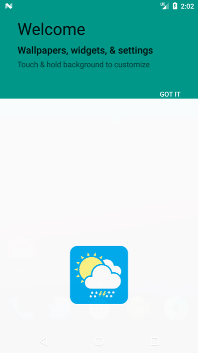

# Android launch splash icon (#3223)

[Issue #3223](https://github.com/WizardFactory/TodayWeather/issues/3223) · 2026-11-26/27

| Before | After, API 36 | After, API 24 |
| --- | --- | --- |
|  |  |  |

- **Before:** Galaxy S21+ (SM-G996N), Android 15, Play release 2.0.1 (200010), 2026-11-26. One frame of a `screenrecord` cold start, cropped and scaled to half size. One UI's squircle mask cuts off the corners, the sun rays and the bottom row of the full-bleed `splash_icon.png`.
- **After, API 36:** `tw_api36_capture` emulator (Pixel 8 profile, 1080×2400, 420 dpi), debug build of commit `2b5fe9aac`. Frame at 2.5 s of a `screenrecord` cold start, cropped. The platform splash draws `splash_icon_inset` (25% inset).
- **After, API 24:** `tw_api24` emulator (1080×1920, 420 dpi), same build. Frame from the emulator's host recording (`adb emu screenrecord`; the device encoder crashes on this image), scaled to 700 px high, taken during the window-open animation. core-splashscreen draws the 60 dp inset variant. The app then opens without an error.
