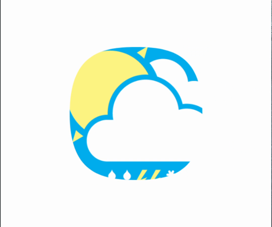
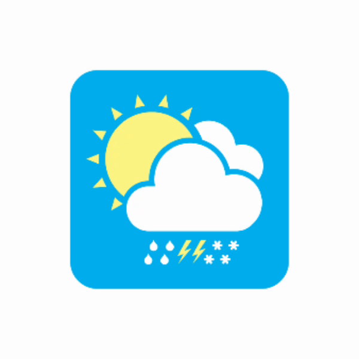

# Android launch splash icon (#3223)

[Issue #3223](https://github.com/WizardFactory/TodayWeather/issues/3223) · 2026-11-26/27

| Before | After, API 36 | After, API 24 |
| --- | --- | --- |
|  |  |  |

- **Before:** Galaxy S21+ (SM-G996N), Android 15, Play release 2.0.1 (200010), 2026-11-26. One frame of a `screenrecord` cold start, cropped and scaled to half size. One UI's squircle mask cuts off the corners, the sun rays and the bottom row of the full-bleed `splash_icon.png`.
- **After, API 36:** `tw_perf_review` emulator (API 36 Google APIs, 1080×2400, 420 dpi), debug build of the PR candidate after review round 1 (26% inset). Frame at 2.0 s of a `screenrecord` cold start, cropped to 600 px. The platform splash draws `splash_icon_inset`.
- **After, API 24:** `tw_api24` emulator (1080×1920, 420 dpi), same build. A frame of the settled core-splashscreen splash from the emulator's host recording (`adb emu screenrecord`, because the device encoder crashes on this image), cropped to 500 px. It draws the 63 dp variant. The app then opens without an error.
- `SplashIconTest` covers 14 densities, from 120 to 640 dpi. For each it checks the Android 12+ circle and core-splashscreen's ring hole, with pixel rounding. These checks found that the first values (25% and 60 dp) were 0.5–0.6 px short at 120, 160 and 180 dpi.
