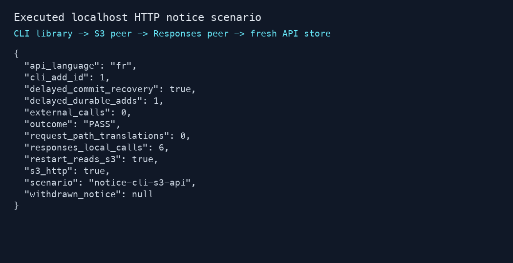

# S18c selected verification

Task issue-2703-s18c, 2026-10-16. Local implementation is verified. The committed-source sequence passed artifact/browser/capture gates and actual visual inspection; independent review and freshCI remain pending. No deployment, production DB/AWS mutation, actual OpenAI payment request or push submission performed.

Red runs compiled the intended missing notice/model/store/API/translation/CLI imports before each corresponding implementation. Green focused checks currently pass19 tests: time/tie/withdrawal/language/validation/public JSON, real forced CAS loser, readback of unknown committed result, unreadable unknown result as uncertain, cancellation after durable commit, cold vs verified-copy failure, invalid/refused writes, partial-language publication/fill-only behavior, malformed/refused/overlimit generation, and a source change while the CLI translation future waits. A full workspace run passed851 tests with0 failures and2 explicitly ignored slow sweeps. Afterwards a targeted Q=0 parameter-case Red reproduced French instead of English, and the case-insensitive fix passed the current19 focused tests, all-targetClippy and another actualHTTP smoke. Full851 is prior-to-that-narrow-fix evidence; it is not relabeled as an exact final-tree full run. Raw JSON literal formatting also changed without changing test input bytes.

The additional actual localhost HTTP scenario publishes via the same CLI command function against HttpS3Transport and an owned S3 protocol peer, translates through an injected HTTP transport to an owned Responses peer, and serves GET via an actual Axum listener with a fresh empty-memory NoticeStore. It observes6 local translation requests, French output, no request-path translation, withdrawal:null and external_calls0. It does not execute the production CLI against real S3 or verify IAM/paid response quality.

Original logs, state receipts, source hashes and active verification inputs remain in ignored reports/s18c and reports/sdlc/issue-2703-s18c. Maintained code/tests/example/manual belong to declared paths. Independent review and freshCI are pending; no merge readiness is asserted by this draft record.

## Required S18C-R1 correction

Independent native review2 identified pending CAS uncertainty lost after unchanged readback. Three delayed-commit regressions failed before the correction (Unavailable/Conflict instead of Uncertain), then all 24 focused notice tests passed (including an existing-object ETag case). Each original operation recovers after delayed commit with exactly one durable add; a changed-base control proves the old CAS returns 412. Fresh HTTP/Clippy and final CI are recorded separately; no live paid API or push call is used. Historical full851 remains before the narrow Q-case fix, not an exact-current run.
