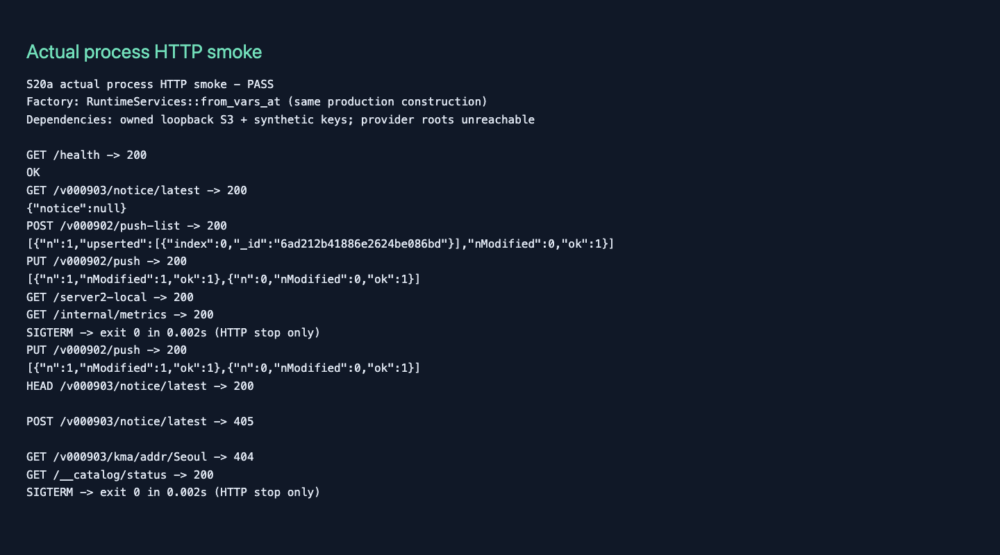

# S20a selected verification evidence

2026-10-16; task #2789 / issue-2705-s20a; initial base20cd322, actual integrated base `d2137b2eb72a441bf4945927bb384be542b117a1` (identical source tree). Endpoint PRE-MERGE; no merge/deployment/send authority.
Runtime candidate: `s20a-source-sha256:87c15ca76fd6342b28d9211aae2373da93715b819b3aa4a3ac0f717cac85a569`. Identity covers the16 changed Rust runtime/test/harness files; metadata/docs are checked separately. Final commit/tree and current CI/review belong to the task PR readiness record.

## Actual outcomes

| Check | Result |
| --- | --- |
| Initial Red |2 intended assertions failed: standalone selection and12s lifetime |
| S20a focused / final post-refactor |14 passed |
| Gateway |58 passed, including S02 wire goldens |
| Older versions |15 passed, including KMA v000901/v000902 and town oracle/S02 goldens |
| Registration state |18 passed |
| Notice backend |24 passed |
| Warning storage/collector |31 passed |
| Delivery libraries |60 passed; no worker process loops started |
| Domestic native switch |5 passed |
| all-target Clippy / fmt |Passed; `-D warnings` |
| Placement |Passed exact declared paths and dependency/resource review |
| Additional functional smoke |Actual loopback_server process, SAME RuntimeServices factory; public registration durable/restart/PUT, notice null/HEAD/read-only, health/private metrics, unselected weather404; no .env or external providers |
| SIGTERM smoke |Both exercised HTTP stops exit0 in0.002s; no full drain claim |
| Manual |Two-page ReportLab PDF; PyMuPDF1.26.5 rendering (Poppler absent), both pages visually inspected |
| Diagram |Separate artifact/browser/visual gates passed; final source pin renewed in follow-up design commit |
| S02 contract tool |18 passed under pinned Node16.20.2 |
| S02 full local recorder |BLOCKED local environment: EADDRNOTAVAIL on owned127.0.0.1 peer; original failure retained. Current exact-head CI goldens remains required. Not claimed passed |

The native fetch tests exercise actual KMA v000902 and DSF native handler outputs byte-for-byte against existing recorded oracles, full language preferences/units, native geocode, strict rejected origins/routes, absent dependencies,3s deadline and selected-Forward legacy attempts=0. The shared production warning acquirer is triggered explicitly in code: source publication precedes feed, rejected head leaves an orphan invisible, retry/restart recovers exactly one event; constructor itself does no gather/send.

## Failures preserved and resolved

Initial PATH/default toolchain failures are setup failures, not behavior Red. New fixture failures (short synthetic data key, cold-write rejection vs corrupt-read injection, lazy oracle warmup/step field) were retained separately. Actual DSF oracle failure revealed that gateway language splitting changed `fr-FR,de;q=0.8`/`zh-TW`; NativeFetch now preserves whole weather headers and normalizes only geocode. Existing gateway regression also caught changed environment-read order; previous legacyURL-before-family ordering was restored. Original failing logs were not overwritten. Initial Clippy reported two collapsible-if cases; both were refactored and final focused tests/Clippy passed.

## Actual process capture

The capture shows actual synthetic calls/results from a copied harness binary captured and hashed inside the shared compile lease. Provider roots were unreachable injected loopback addresses; the only serving persistence peer was task-owned loopback S3. No real AWS/Mongo/provider, FCM/OAuth, paid translation or production environment was used.

## Reproduction and retention

From server2, run `cargo test --test runtime_services`, the gateway/state/notices/warnings/delivery/legacy_versions suites, `cargo test --test domestic switch::`, `cargo fmt --check`, and `cargo clippy --all-targets -- -D warnings`. Use the installed pinned toolchain. Compilation used the shared lease and existing target, jobs2/debug0/incremental0 with3GiB cutoff; no targets/evidence deleted. The additional process smoke used the maintained `loopback_server` example and owned S3 peer with synthetic settings, then restarted and observed a matched PUT.

Raw logs/state remain in the task-owned ignored reports tree for active reviewer access; selected outcomes and these hashes are durable. CI artifact retention is7 days; code/tests, this record, manual/PDF/capture and PR review/readiness comments retain essential decisions after expiry. Historical S18c notice CLI manual stays a backend/publishing record; the new runtime manual is the serving supplement. README, architecture and affected API/operations contracts were assessed; no frontend/native-client/build contract changed.

| Retained execution file | SHA-256 |
| --- | --- |
| red.log | `67dd02e5cde1477ad8f4ac434a60832a7d687b8ac8c279ee6ee795c4102b17df` |
| green-7.log | `c822998197a57615fa3a7f967b91bbd4fea32f01281e413e8d3b72a2b1a39d80` |
| green-8.log | `9a94b9f2123a27fea444b22c14f6f30e02df3a39672d533c2f7b08584316fa19` |
| post-refactor-3.log | `e827df121da10c2556f81ecbdbead7caca9ad40f18d428a4495cc374ada2a8f2` |
| regressions.log | `32b40aea387a52042c2a48b016f288a86aa2730b4b3dc6a77452e64465f2c790` |
| regressions-2.log | `e4181adb3e1cef48da911f2c4bb926b059dff57f78b9fd90506994911d5550b6` |
| domestic-switch.log | `dbb1c4d5e60c188f839d8f47efbfe80e97347086b04789b38e3e94f014659f8d` |
| clippy-2.log | `12b936b1b1eb37328fb48f2f66033bd5403df84afc7767f57e170a0544675429` |
| smoke.log | `b1a0f66c225b82237a5d023a8ce6ea3d91678d93099f9f9ca45532b441f8dc0d` |
| smoke-results.json | `f338270d16e105972caa1f6faa4bfa73202f81fae1ad5f6c1ac95de0b2459e4b` |
| smoke-binary.json | `00e0523b7f80f3a65a73fda7e0a417c635370b97b31065a3c53e2796d1a3c8f5` |
| s02-goldens.log | `ee58c89d5fbc39860df976ab511b4962e7fd15469fbacc709bc66daa119ca402` |
| s02-goldens-2.log | `06d67f9164f4bc89650fe493337a361277701d50040d10611bbefd0b78a32ea5` |
| s02-goldens-3.log | `8624b3b0f9e4a4e837eeac5271be3c84a5b3062061e4626372596e36fece97c6` |

Worker supervision/global drain, delivery credentials/sends, live provider/IAM/quota checks, #2742 completeness and #2705 cutover/production activation remain outside S20a. Independent review and current exact-head CI are still pending at this pre-commit evidence revision.
