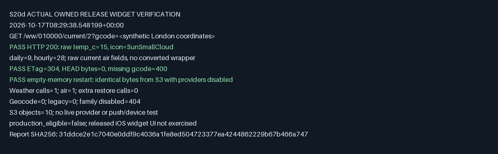

# Native retained-widget verification — 2026-10-17

AK retained existing widget support and included `GET /ww/010000/current/2` in native migration. The historical 19 groups and 220,583 request denominator remain unchanged; this is a required supplement with unknown historical volume.

## Selected actual local result

Owned release smoke: **PASS**, finished `2026-10-17T08:29:38.548199+00:00`. Command:

```text
python3 server2/tools/widget_smoke.py --binary <retained release/server2> --output <new evidence directory>
```

- Release server2 SHA-256 `97a81cfbefaf1fea0ded193b78b231156412af84cd02131e9803bc4e23549091`.
- Matching loopback example SHA-256 `45027f1604d4289dda20b5e5d43eb5d99205db5157bf313ae0623ce844f60786`.
- Selected report SHA-256 `31ddce2e1c7040e0ddf9c4036a1fe8ed504723377ea4244862229b67b466a747`.
- Tool SHA-256 `3d3fcdb17fd13eafd606fb2fad506fd930dc94cc943d30bb999a775551b02b22`.
- Response SHA-256 `7cd4244ac869118517e0a7d3389974ecae4dc68fe9f26b31b627c91723f7ac21`. Raw temperature `15`, icon `SunSmallCloud`, 9 daily rows, 28 three-hourly rows.
- Cold/warm HTTP 200, matching ETag 304, HEAD empty body, missing gcode 400. With dsf unselected, 404.
- Empty-memory restart on the same owned S3 peer, providers disabled: identical weather and air bytes. Weather calls 1, air calls 1, no extra restore calls. Geocoder 0, legacy 0; 10 S3 objects.



The capture is formatted from the selected JSON, not a device screenshot. Live provider, AWS, push and device calls were not made. Device-sends zero describes this isolated no-send setup, not a production counter. Native source mapping was retained with the build; source bytes, executable identities and old failed invocations were not relabelled.

## Contract and regression

The named S02 legacy recorder exported 14 actual HTTP cases on pinned Node 16.20.2 with UTC, isolated dependencies and network denied except owned loopback. Two final exports are byte-identical. Frozen fixture SHA-256 `f70690200e6d83ad20268f0702a544ef0bf97ceba585999241c9c4840b9c324e`. Native replay checks raw Tokyo and requested units metadata, Korean/Japanese/Chinese, raw current-only air, HEAD/304, missing/malformed gcode, invalid version, initial provider 401, subsequent provider-down 503 with retryAt/Retry-After/no-store, and generic 500. Session, Date and connection/framing metadata are excluded from wire comparison. Status, body and functional headers stay exact.

Initial tests compiled and failed for the missing WW body and the collapsed 401; both intended reds are retained. Final world tests: 41 passed. Matching runtime-source regression: library 93, gateway 58, observability 3 and runtime-services 22 passed, 1 ignored. Format and all-target Clippy with `-D warnings` passed. Existing cutover Python controls: 5 passed. Existing S02 baseline: 76 cases in 19 groups passed two fresh full recordings; only `source.oracle_sha256` changed after the recorder extension, with all old bodies, headers, inventory and dependency traces unchanged.

Initial release smoke retained a wrong assertion requiring the coordinate route's converted air wrapper on the raw widget. Its cleanup also assumed stderr was piped. Both whole failures remain retained. The assertion was corrected against actual raw legacy air fields and a separate frozen raw-air case; cleanup now handles the retained log sink. The selected later smoke passes. This does not recast those earlier executions as PASS or treat setup/oracle failures as product Red.

## Maintained boundaries

All runtime, fixture, smoke and CI logic is under `server2/`. The exact legacy exception is the existing `server/test/offline/golden-record.js`, for test-only export. Runtime uses no legacy source/data. S20d's declaration and placement/artifact gates cover the final paths. The [editable operator manual](../../../operations/server2-widget.md), [PDF](../../../operations/server2-widget.pdf) and updated cutover workflow keep qualification limits explicit.

The source iOS widgets call this URL, but some parser fields differ from the current legacy body. No client binary was changed or executed. Production exact-revision parity and shadow, real-host listener/capacity/quota, state handover, an eligible complete previous release and separately scoped switch authority remain open. Local PASS does not close #2704/#2705 or make production eligible. #2805 and #2724 are outside this increment.
