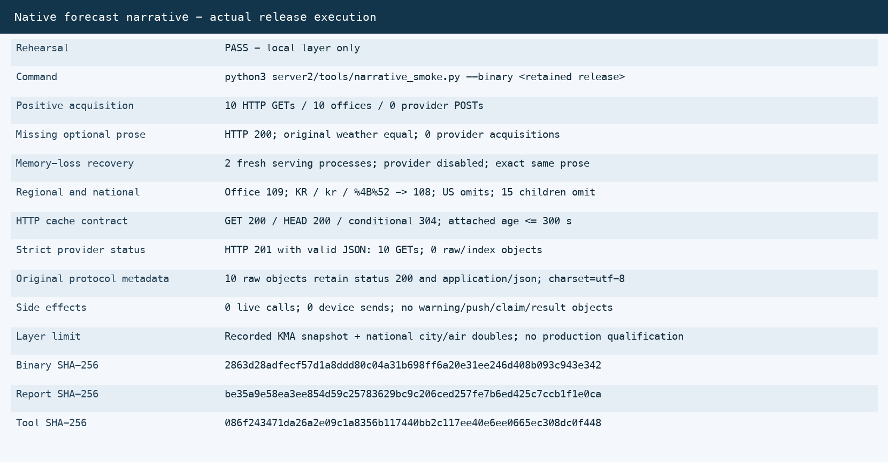

# S20e native forecast narrative verification

Observation: 2026-10-17. [Issue #2809](https://github.com/WizardFactory/TodayWeather/issues/2809).
Implementation base: `9333d196846b1c04989b36128d3a7e06f74aa927` (merged legacy PR #2805).
This record covers native repository code and owned local verification. It does not close S19/S20 or authorize production work.

## Contract and implementation

Optional `forecastNarrative` is native on successful domestic KMA/town and national KR responses. Ten offices, province aliases, ordered fields, strict KST calendar validation, freshness and original LF-normalized Korean text match the named fixed legacy oracle. Missing or failed optional reads preserve base weather. National children omit the object; other countries receive no national prose.
Acquisition runs in a delayed, owned 180-second worker, with independent per-API funding. HTTP construction/read does not acquire prose. S06 raw records retain original bytes/protocol metadata. A conditional-absent single-record catalog commits the first winner; later or orphan raw objects cannot replace it. Memory loss reconstructs fresh committed prose from S3.
See the [operator source](../../../operations/server2-forecast-narrative.md) and [design workflow](../../../architecture/diagrams/server2-forecast-narrative.html). The diagram is a proposed design contract, not runtime evidence.

## Actual checks

- Intended cache Red: compiled assertion failed with exit 101 before the writer fix. Strict HTTP201 Red: the earlier release published 20 raw/index objects and failed the zero-publication assertion (exit 1). Setup/compiler failures are preserved separately and are not labeled Red.
- Oracle: 21 cases, ten offices, full alias comparisons, numeric JSON forms and JavaScript whitespace handling. Named legacy source hashes and the frozen clock are retained in the fixture provenance.
- Final fmt, clippy (`--all-targets -- -D warnings`), focused Green, whole workspace post-refactor test and release build all exited 0. The whole execution has 30 result rows: 924 passed, 3 ignored, 0 failed. The outer test runner is serial; test-internal concurrency assertions remain enabled.
- The first two whole-suite failures remain recorded. The second exposed macOS `AddrNotAvailable` (OS49) on loopback connects. High-read test call sites now select the existing bounded persistent S3 peer. Default-peer, framing/CAS/fault controls passed; production transport and deadlines are unchanged. This is evidence of the local transport failure, not a measurement of the entire ephemeral-port pool.
- The separate final release smoke uses actual funded provider HTTP and catalog/raw S3 code against owned peers, then fresh product HTTP serving processes with the provider disabled. It checks base weather equality, regional/national selection, HEAD/304, two memory-loss restores, original metadata and rejection of valid JSON HTTP201.
- No live provider, notification, database, deployment, mirroring or #2724 measurement was performed. Device-send absence follows the local tool boundary; this is not a wire-level device counter.

## Execution identities

- Final smoke report SHA-256: `be35a9e58ea3ee854d59c25783629bc9c206ced257fe7b6ed425c7ccb1f1e0ca`.
- Retained release example SHA-256: `2863d28adfecf57d1a8ddd80c04a31b698ff6a20e31ee246d408b093c943e342`.
- Smoke tool SHA-256: `086f243471da26a2e09c1a8356b117440bb2c117ee40e6ee0665ec308dc0f448`.
- Verified source map SHA-256: `fa36d67603e72243c23a382999acfc481fd8871b61f460fbdae06fef0c8161c4` (691 declared native input paths).
- Positive provider GETs: 10; strict-status fault GETs: 10; total: 20; provider POSTs: 0.
- Positive stored objects: 22; HTTP201 raw/index objects: 0; fresh serving processes after acquisition: 2.
- Selected execution capture SHA-256: `8c531f21f2f2d60031a17a8d0500af5004b92b7ed7538b7c7217c260f6e0ad63`.
Commands are reproducible from the operator guide. Detailed failures and run receipts stay in ignored task reports; this selected contract, identities and capture survive CI artifact expiry. Final candidate/commit, independent review and integration outcomes belong in the durable PR and linked issue records.

## Limits and next gates

The weather input is a selected frozen native KMA snapshot, and national city/air dependencies are doubles. This is not full provider startup, production parity, host/IAM/TLS verification, quota headroom, an installed-widget UI test, or qualification of a complete previous release. Earlier functional-debug3 was a different binary/tool and is not the final receipt. The current inventory retains the historical 19-route traffic denominator and adds prose as a response supplement.
AK order after this port: actual widget compatibility, an eligible complete server2 rollback bundle, then operational environment verification. Seven-day shadow, production performance/quota, final state/rainfall handover and separately approved cutover remain open. #2724 measurement remains excluded.
