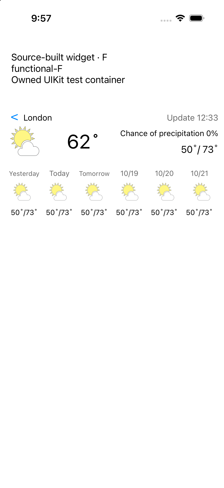

# Source-built widget repair verification

Date: 2026-10-17. Source base: `b56ce85c2a8ece0fc0de93de4dca68d97d77b5cf`.
Scope: [#2811](https://github.com/WizardFactory/TodayWeather/issues/2811), TodayWeather legacy native widget display and its standalone target link. The server2 `/ww` contract, TodayAir and the Cordova app link are unchanged.

## Actual observations

The final portable project check fails on the original project because `libCordova.a` is in the widget framework phase. It passes after removing that one membership and also asserts that the app keeps Cordova and the widget keeps NotificationCenter. Earlier parser setup errors were retained as setup failures, not Red/Green evidence.

The same replay source, fixture bytes and captured response were used before and after the product correction. The original actual widget objects fail raw C/F daily display, short-date exception handling and integrated C/F display. Normalized coordinate C/F and KMA C/F pass before and after. The corrected real widget target builds with Xcode 27.1's iOS Simulator SDK, arm64, deployment target 15.0, with signing disabled. No Cordova stub or copy-only linker patch is used in that build. The build copy replaces the key and endpoint with synthetic loopback configuration; original files remain unchanged except the two declared product edits.

The corrected UIKit replay passes all 9 cases: raw C/F, normalized coordinate C/F, KMA C/F, short date and integrated C/F. Assertions cover every one of the six dates, temperatures and icons, row cap, zero/negative values and raw/normalized year boundaries. The renderer guards non-string dates too; no broad malformed-KMA recovery claim is made.

Separate integrated C and F runs drive the real URL builder, NSURLSession callback, `processGlobalAddress`, storyboard and expanded view using a retained native response. Current values are 16.7 C / 62 F; today and all six synthetic daily rows are 10/22 C / 50/73 F. The temperature display retains its existing truncation. Each functional run observes exactly one allowed loopback WW request and zero blocked HTTP(S) requests. An NSURLProtocol double returns the response and rejects every other HTTP(S) request; the server is not re-executed in this client check.

The response came from the earlier owned native loopback WW run, SHA-256 `b5157fc9086b3c365ba6c99d4c8bd8636686bf966a7b599ec88d297fffd97e0d`. Replay source SHA-256 `9b4759e4e36ac7af1b8aefa7b0879e1b12af63846f698213817fd6ac8a6c6c62`; regression fixture SHA-256 `07594c33104570508345794d0a5c0da866639159ac40c4fd4c78849c0f6088c8`. These identify the Red/Green oracle, not a deployed app.

The new correction cycle used exactly 3 compilations: baseline UIKit host, actual corrected widget target, corrected UIKit host. The prior S20f three-attempt ledger was preserved. Scenario replay reused the host binary without further compilation. Only the task-owned Simulator was installed/launched and is retired after verification; no production provider, AWS operation, App Store release or live push was used.

## Reproduce

```sh
python3 tw.ios/tests/widget/test_project.py
python3 tw.ios/tests/widget/run_replay.py prepare --help
python3 tw.ios/tests/widget/run_replay.py run --help
```

Preparation copies the actual built objects/resources and emits the explicit host compiler and ad-hoc signing commands without running them. Supply sanitized built widget objects/resources/headers and a recorded response, then compile under an explicit attempt budget. `run` requires a matching task-owned Simulator receipt, an owned app bundle and a new output directory. It installs, launches, checks the JSON receipt, captures the screen and terminates the test host. The CI workflow runs the portable link check on Linux; it does not claim a native CI build.

## Visual and platform bounds



The selected image is the unmodified functional-F Simulator screenshot. The maintained [editable guide](../../../operations/server2-widget.md) and [PDF](../../../operations/server2-widget.pdf) include C/F scenario instructions and actual image excerpts. All four PDF pages were rendered and inspected; screenshot viewports omit only unused lower test-container space.

Apple [removed legacy Today View extensions in iOS 18](https://developer.apple.com/documentation/ios-ipados-release-notes/ios-ipados-18-release-notes). The installed iOS 26.5 environment validates actual legacy UIKit objects in a test container. It does not validate Springboard extension activation, an App Store IPA, a deployed client or WidgetKit. Modern widget activation remains [#2605](https://github.com/WizardFactory/TodayWeather/issues/2605). This local client repair does not close server2 operational gates #2704/#2705.
