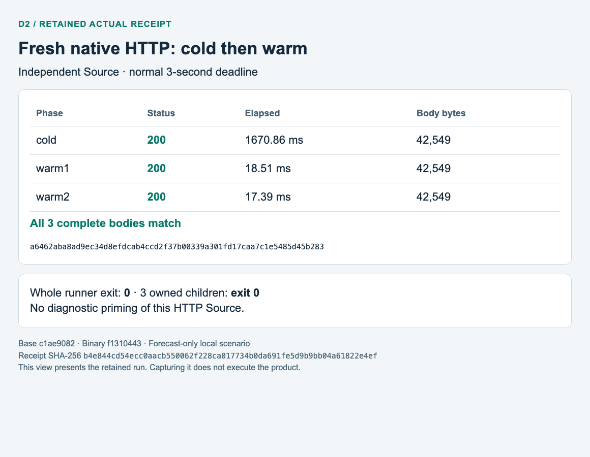
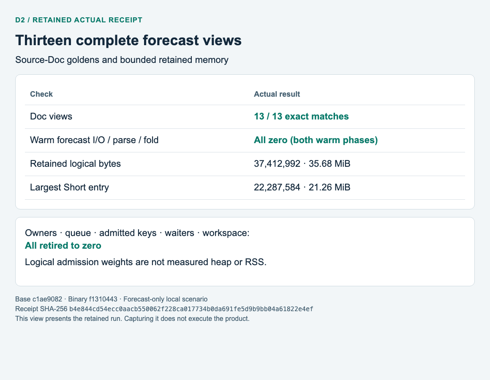
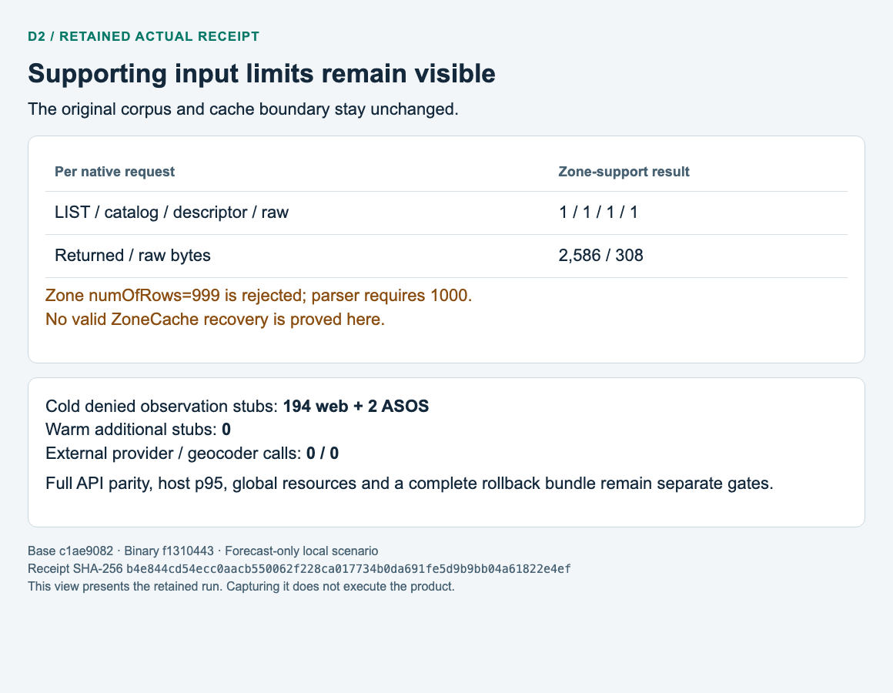

# D2 forecast memory: selected local verification

Scope: #2819 complete Source-local Grid/RSS/Mid views above base
`c1ae9082b2c86f0087727be9872b0cf82b4e3bb1`. This is pre-merge evidence, not
production qualification or closure of #2704/#2705/#2819. The source/test/fixture
maps and raw execution logs remain in the ignored task artifact index.

## Retained executable and input identities

| Input | SHA-256 |
| --- | --- |
| Optimized `domestic_warm_cache_smoke` | `f131044392694657919864caee1a95539359c736d4f0e6225127235a8069d68b` |
| Smoke runner | `a9b1e1a194188e3fb31c325b0fdd128f5b566cd58d2bfe6b0c3cdc1282272a84` |
| Original fixture manifest (730 acquisitions / 851 seed pages) | `11606b79c26365e4ba8a5a906d5801f717845f853bafc971c2f099d27b7bbe3f` |
| Final actual summary | `b4e844cd54ecc0aacb550062f228ca017734b0da691fe5d9b9bb04a61822e4ef` |
| Current library test executable | `bde2b29810940fdf13240b8c68fe8c45ecd152772f9e6292df265af57ecfc93f` |
| Current domestic test executable | `715886c407454b0ce88d11a85bb93f626c9cba14720f60f4c322a65ef0d42d6e` |

The actual runner exited 0 in 11.204 seconds. Seed, diagnostic and HTTP are three
separate owned children, all exit 0; peer and HTTP listener retired, and source
input groups were unchanged. No provider credentials, live endpoints or sends
were used. Captures below present these retained actual receipts, not new runs.

## Current checks and additional native HTTP

83 distinct Rust checks passed: Items 8, Doc 4, Mid 3, cache 6, RSS 2, Grid 1,
focused forecast-cache 5, domestic source 36, late-publication 6, S16 summary 10
and domestic parity 2. All-target Clippy with warnings denied and fmt passed.
Six additional pure checker methods passed, covering all 78 forecast nonzero
counter mutations, missing expected/classified labels, unknown labels and
preservation of optional/unattributed counters. These verify the assertion
boundary; they do not substitute for the actual native HTTP flow.

| Independent phase | Cold | Warm 1 | Warm 2 |
| --- | --- | --- | --- |
| Diagnostic complete Source-Doc views (60-second inspection budget) | 1958.88 ms | 3.75 ms | 3.79 ms |
| Fresh native Gateway / DirectRoutes / KmaBackend HTTP (normal 3-second budget) | 200 / 1670.86 ms | 200 / 18.51 ms | 200 / 17.39 ms |

The thirteen forecast datasets contain 729 generated acquisitions / 850 pages; one zone-support acquisition brings the seed to 730 / 851. Diagnostics select 725 forecast acquisitions / 845 pages. All thirteen Doc views match their complete goldens. Diagnostic retained logical
weight is 37,412,992 bytes (35.68 MiB); the largest Short entry is 22,287,584 bytes
(21.26 MiB). These are charged logical weights, not live heap or RSS. Both warm
phases add zero forecast LIST/catalog/descriptor/raw GET/returned bytes, parsing
and folds. Final owner, admitted-key, workspace, waiter and queue gauges are zero.
The fresh HTTP Source was not primed by the diagnostic run. All three HTTP bodies
are 42,549 bytes, SHA-256
`a6462aba8ad9ec34d8efdcab4ccd2f37b00339a301fd17caa7c1e5485d45b283`.

## Limits and retained failures

The original supporting zone-list fixture has numOfRows 999. The existing parser
requires 1000, so the independent ZoneCache is not installed. Every native
request repeats exactly one zone LIST/catalog/descriptor/raw GET, with 2,586
returned bytes (308 raw). Those explicit counters remain outside the specified
forecast cache. Cold observation stubs are denied: 194 web + 2 ASOS, with no extra
warm stubs; external provider and geocoder counters are zero. Valid-zone recovery,
complete API parity, live provider collection, concurrent p95, EC2 capacity,
whole-process resource integration and a complete recovery bundle are unqualified.

Original failures are preserved: raw-32 rejection of a legitimate 49-field Mid
item; debug full-history owner timeout; optimized quadratic duplicate work causing
native cold 502 at 3002.28 ms; and the first corrected-runtime run's overbroad warm
checker failure after actual 200. The last case included independent zone work;
the corrected checker enumerates all thirteen required forecast labels plus the
zone label, rejects unknown/missing labels and retains every excluded counter.
No corpus, timeout, response or forecast zero-work assertion was weakened.
A process sample implicated duplicate comparison, rather than the initial
checked-store hypothesis. A bounded borrowed index fixed the measured hotspot;
semantic identity/order controls passed before and after that change.

The [editable operator guide](../../../operations/server2-domestic-cache.md) and
[PDF manual](../../../operations/server2-domestic-cache.pdf) cover the same run.
All three rendered PDF pages were visually inspected. Detailed editable capture
JSON and original logs are preserved in ignored task artifacts. No production,
shadow, merge, cutover or device send was performed.
