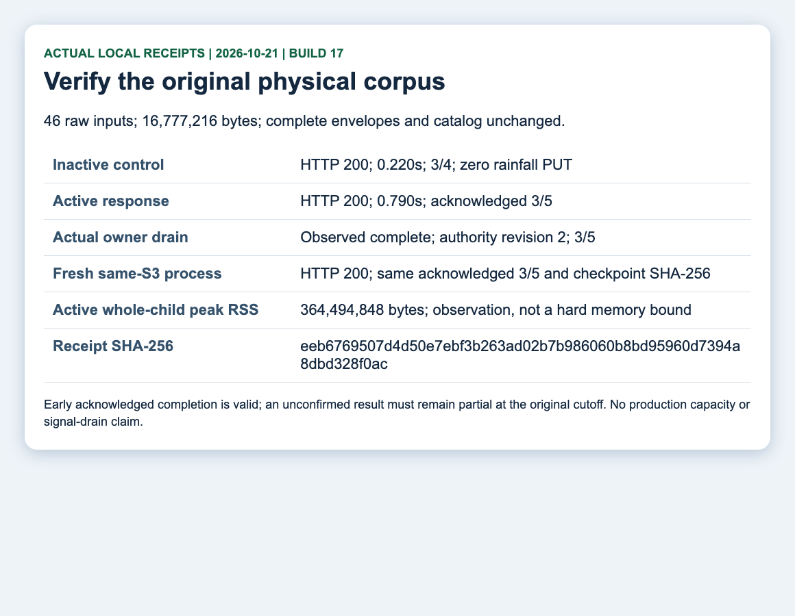

# F2 rainfall ownership: selected local evidence

This is repository preparation for issue2819. It does not establish production
activation, actual ASOS provider access, a host memory budget, process signal
lifecycle, a complete eligible rollback pair or issue2704/2705 completion.

The sections below through the historical architecture binding preserve earlier,
revision-bound runs. The dated build17 section supersedes their current-candidate
claims; original failures and prior measurements are not replaced.

## Input and behavior

AK selected compatible mapping of the existing national `kma-web/aws-minute`
web rows. There is no new collector or official-ASOS API. Per original ObjectId,
use the canonical Current publication end, the strict preceding one-hour window,
at least15 actual rows and one known rainfall boolean, then legacy any-true
calculation. Preserve imported cumulative totals and duplicate-station ObjectIds.
Only canonical rain predictions (`pty > 0` or `rn1 > 0`) are eligible; observed-dry
is a miss on that prediction, not new counting of dry forecasts.

Runtime updates only an existing schema1 authority. Counters, last end and input
receipts commit together with conditional writes. Absent authority stays inactive.
Unknown, corrupt or mismatched state does not expose optimistic or stale seed totals.

## Historical pre-P2 owned checks

The current caller-boundary correction has a meaningful original-API Red for a
result and timer both ready after the cutoff. Corrected focused checks:8 library
rainfall tests (2 ignored),16 domestic rainfall tests,8 private observer tests and
10 Python controls passed. Expanded regressions passed427 with5 ignored and0 failed
across library, catalogs, domestic, raw_records and state.

Six normal native HTTP scenarios returned200. Complete bodies match the prior
normal candidate: inactive3/4 with zero rainfall PUT, acknowledged4/5, repeat and
restart4/5, next dry4/6, corrupt-authority core weather with station partial.

The exact same46 raw envelopes/bodies totaling16MiB plus catalog body/ETag/version
were preserved from the original pressure corpus. Inactive:200/0.688597833s,3/4,
zero rainfall PUT. Active:200/2.557937542s, core present; unconfirmed rnsHit/rnsCount
and cityMinAws omitted. Actual owner drain commits revision2/3of5, then the old
child exits and a fresh same-S3 child returns200/3of5 without reset/reactivation.
All owned children were reaped. Terminal observations qualify only the observed
example/rainfall permits, not global CPU completion or final wire flush.

Peak active whole-child RSS was453,967,872B. The former502/3.004s result remains
preserved; neither the caller correction nor logical64MiB projection accounting
qualifies physical heap/RSS or production concurrency capacity.

## Execution identities

The owned example injects a fixed clock, denied providers and a loopback S3 peer.
It traverses Gateway/DirectRoutes/KmaBackend TCP, not RuntimeServices/process signals.
It recorded zero live provider calls and zero Mongo writes.

- Native example SHA-256: `c6744eaf5774c379e12828a7d3f8bd4a2dd635c074856be66d6bc53ba703ea29`.
- Runner SHA-256: `78cc7e859f55c99f53f60ab0874e2537f2ac23173e9f7934773e41c61ddf47a9`.
- Normal full receipt SHA-256: `7ac3df5c24307ff4114bb2ffa8b6fa2dd126e8243407e4dc46d8f5f5e435765f`.
- Pressure full receipt SHA-256: `e0f32c5fca9fb10754e73b455f90c4c5ca7bf2ad9ca419f4952ce57649da5c28`.
- Normal body comparison SHA-256: `e70e2c6102d48d2948c8a4a768abc8bda6e1b769bae764df99d8da51bea4614d`.
- Full physical corpus comparison SHA-256: `4ddad069ad8cef940b2ef7bf48ae1ed13317be1fef95eeb1eb6f8bd177cf7901`.

Later equivalent source-only Clippy rewrites are separately bound to their exact
focused schema/test checks and quality receipts. They do not relabel this executable
as a newly executed binary. Final hashes, formatting, diagram/manual verification
and independent PR review remain gates before readiness.

See the [operator procedure](../../../operations/server2-rainfall-handover.md).
The selected capture displays these retained receipts; viewing it is not an additional
product execution.

## Quality and manual binding

- Lint8 393-input source map SHA-256: `83413fdee266291a4323b48f5c6896f61e11a730f849b082aaf2f3bec3e28699`.
- Equivalent rainfall-store rewrites:3 exact schema controls passed; two test-only rewrites:2 affected controls passed.
- All-target Clippy `-D warnings`: exit0 on lint7; final change is only two whitespace layouts.
- Workspace fmt check: exit0 on lint8. Original lint/setup/fmt failures are retained.
- PDF SHA-256: `f881c9d8236b991c566b70560210f9a2684324c0d17fa887a6a1601a8a4de07d`. All three rendered page images were read.
- Selected pressure receipt capture SHA-256: `16cd3e632ab21e850fc5f8c39b9ebccfac9d6f97ceb104c91ec9529e1cd5fb35`.

The [editable manual JSON](manual.json) and all three selected images are maintained
beside this evidence, so the screenshot PDF rebuilds from a clean checkout. Full raw
receipts and temporary page renders remain in ignored task evidence.

A later placement check rejected two multiline HTML literals and one escaped
quote-containing expected path string. Build9 uses compile-time concatenation and
raw spelling with identical complete runtime string bytes; no checker exception
or fixture/corpus change. Current393-input map SHA-256 is
`ff8d0b4a1d5130f66045874a0e3d661338fd6c721b3ebb1c984b991d89ee5d27`.
Actual workspace formatting, placement and all-target Clippy passed; three existing
inactive, active and transport controls passed on newly copied binaries. The
427-check regression and native example above remain explicitly earlier executions,
with reviewed equivalent lint/literal-only changes, rather than fresh build9 runs.
Earlier source maps and original failures remain revision-scoped.

The PDF wording distinguishes eligible canonical rain predictions from an observed-dry
miss. Its3 rendered pages were re-read after that clarification.

## Historical committed architecture binding

The maintained [runtime ownership diagram](../../../architecture/diagrams/server2-runtime-services.html)
is regenerated from actual committed source `5b935299580d8c7b29a8489fd1587cd78e96e45c`.
All26 source references are retained. Showcase validation, artifact/provenance and
real-browser gates passed; four1440/2048 light/dark captures were individually read.
The selected layout has zero crossings and one readable three-bend shared-S3 branch.
This diagram documents repository wiring, not an executed production stop/activation.

## Current-master P2 verification (2026-10-21, build17)

Source snapshot `3a31a023f21c4e7f62593e7b0b5ffd735518be0a` has parents `17098d1b` and master
`e09672a3`. The tested identity is `source-sha256:2482c9b20a7e14ead3cc2f4ce238619ecd715b18129dedbc6bab54853002b2fc`: SHA-256 of the explicit base
and all795 tracked server2 input-file hashes. Documentation is bound separately;
later matching commit mapping does not relabel an older executable as a new run.

- Full workspace, default scheduling: **1,124 passed / 0 failed / 9 ignored**,
  31 result rows; fresh locked/offline Rust1.99 compilation. No ignored test is counted
  as executed. Strict all-target Clippy and formatting passed.
- Owned operator prerequisite/readback:1 passed; diagnostic controls:8 passed.
- Normal native TCP: all six HTTP200 bodies equal build16 byte for byte; inactive3/4
  with zero rainfall PUT, acknowledged4/5 once, repeat/fresh-process4/5, later dry4/6,
  corrupt authority with truthful partial statistics.
- Original physical corpus:46 raw records /16,777,216 bytes. Every raw body, complete
  envelope and catalog body/ETag/version matches build16. Manifest changes are the
  execution wall cutoff and source-file provenance; all selected fetch times precede
  both cutoffs. No corpus, deadline, capacity or expected-response relaxation.
- Inactive200/0.220s/zero rainfall PUT;
  active200/0.790s/acknowledged3of5. Actual drain and a fresh same-S3
  child retain revision2/3of5 and checkpoint `4433c58cb1cd3408ca57c3d54bb79cb84aaf0d1965141888a876454a32835ed8`.
  Whole-child active peak RSS **364,494,848 bytes** remains a measured
  limitation, not a physical heap/RSS or production throughput guarantee.
- All owned children exited; provider calls and Mongo writes are zero. The examples
  use fixed clock/provider denial and Gateway/DirectRoutes/KmaBackend TCP; they do
  not qualify RuntimeServices signals, a production host or a full recovery pair.

P2 separates128 read tickets from8 mutation intents, joins same-grid/end work,
shares only overlapping authority probes without a completed/negative cache, and
retains independent input cutoffs/deadlines and full-scope validation before sharing
heavy projection work and one conditional writer. Both operator verify and activate
require complete exact imported S06 seed proof even when a local file matches.
Prior RF-CLAUDE findings require renewed independent confirmation; these author
checks are not a reviewer resolution or PR/CI PASS.

Execution identities:

- Native SHA-256: `3f2db44591011092870e793ee4524541748fc1c282cd6d706e35b1f2856d944c`.
- Runner SHA-256: `2de0de51567323b66f3aaf01bb980e96fa7ea08ffa55e85b029ad69d4b5010c0`.
- Normal receipt SHA-256: `5f160a352f18c0ad736edf388b4a4022d6b814e1928b5fe9827a296cf600734a`.
- Physical receipt SHA-256: `eeb6769507d4d50e7ebf3b263ad02b7b986060b8bd95960d7394a8dbd328f0ac`.
- Full comparison assessment SHA-256: `bb1b59d8715b5a17557aab555fa780aab6dfe87df178422f7c3f728b6838cf14`.
- Physical manifest SHA-256: `d5c5e6a485511994dd23f7c5f029d954eb887048882d3ce268fb0a4eadc5216d`.
- Current PDF SHA-256: `c5ebb29ca03940f365c975541938ef7a87286e12259b6ca3d28c5d8365ec0564`.

The editable manual JSON, three receipt captures and all three rendered PDF pages
were checked against these current results. The source-bound ownership diagram now
pins `3a31a023f21c4e7f62593e7b0b5ffd735518be0a`; artifact, provenance and real-browser checks passed.
Four light/dark captures were inspected for the main scene; footer card bodies extend
below the captured viewport, a retained visual coverage limit. Original pre-P2 layout
and failed recordings/checks remain preserved. Current CI, eligible PR review and all
production activation/recovery/capacity gates are separate from this local result.
