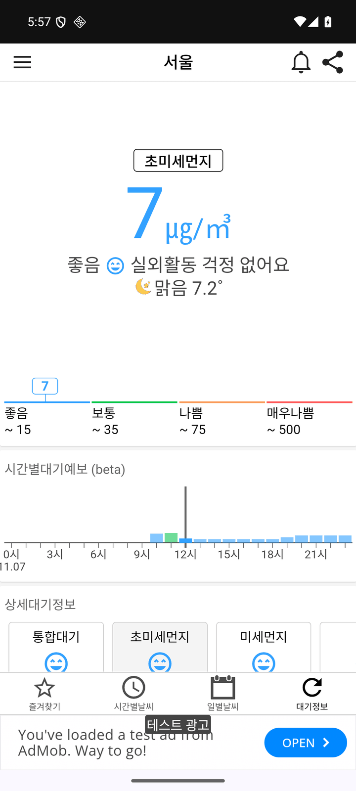

# Check fine dust levels and monitoring stations

1. Open **AQI** to see the air quality grade and activity guidance for the selected location. **Hourly AQI forecast** shows how conditions are expected to change.
2. Under **Air Quality Details** (상세대기정보), select a pollutant, such as PM2.5 or PM10. The value, unit and grade change with your selection.
3. Scroll to **Station** to check the measurement site and publication time. Tap a nearby station to see its readings. When comparing a reading with a forecast, check the forecast source and time as well.

PM2.5 and PM10 concentrations are reported in µg/m³. For gases, use the unit shown beside the reading. The overall air quality index combines information about several pollutants. If a grade looks unexpected, check **Index Standard**. In areas without measurements, the app may show the grade scale with no value or station.

