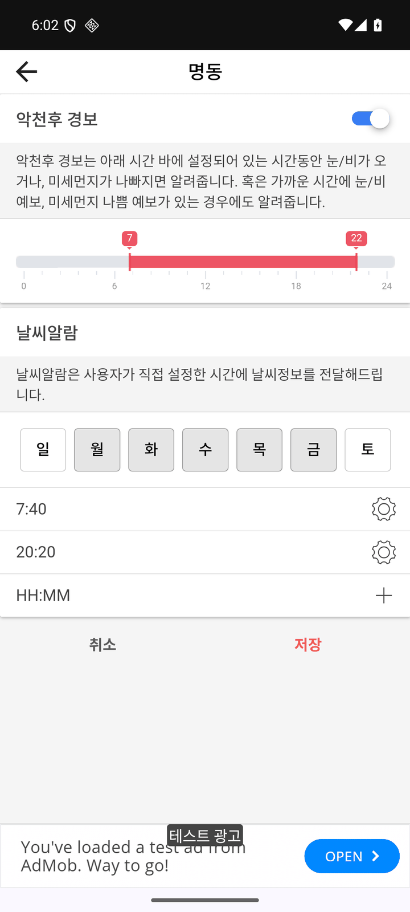

# Set weather alarms and severe weather alerts

Choose the place you want notifications for, then tap the **bell** on its weather screen or beside its name in **Locations**.

- **Weather alarm** (날씨알람) gives you the weather at set times. Select the days, tap **HH:MM +**, and choose the hour, minute and AM or PM. Confirm the time, then tap **Save** at the bottom. Tap an existing time to change or delete it. On Android version 1.1.1, you can set up to five times. Selecting 12:00 AM removes that time.
- **Severe weather alert** (악천후 경보) lets you choose when to receive alerts for rain, snow or worsening fine dust. Set different start and end times on the time bar, then tap **Save**.

If you leave the screen and the app asks whether to save, choose **Save** to keep your changes. If notifications are turned off, open your phone's settings and check notification permission for TodayWeather.

