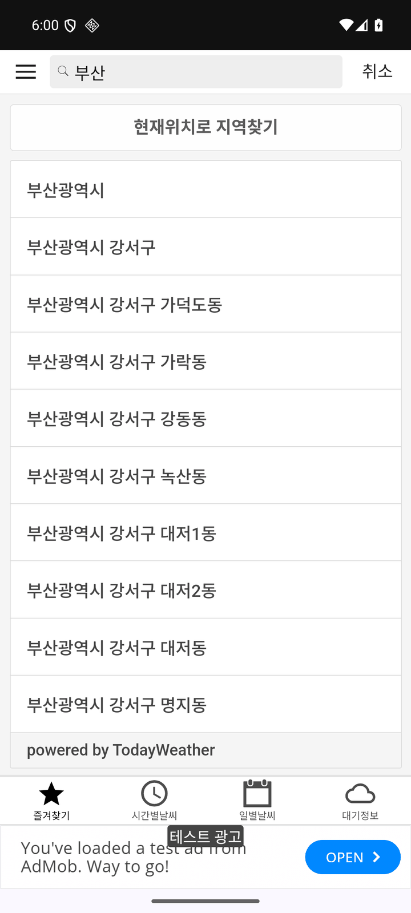

# Add a location on Android

1. Open **Locations** (즐겨찾기). For this example, enter **부산** (Busan) in the search field. You can also search for cities abroad, such as London.
2. Check the name and address in the results, then tap the place you want. If the first tap closes the keyboard, tap the result again. The app opens the weather view for the selected place.
3. Check the place name at the top. Open **Locations** again to find it in your saved list.

To save the area you're in, tap the search field, choose **Find by location**, then tap the area the app finds. If weather for an overseas city is temporarily unavailable, try opening it again later.
