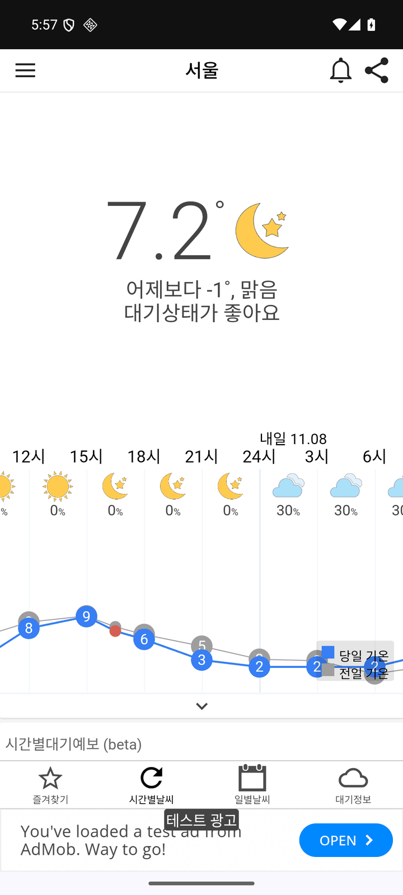

# Compare today's temperature with yesterday's

Open **Hourly** (시간별날씨). Below the current temperature and sky conditions, the app compares the temperature with the same time yesterday. A difference of −1° means it's one degree cooler now.

On the chart, the blue line shows the temperature for the day you're viewing. The gray line shows the temperature 24 hours earlier. The red dot marks the current temperature. Swipe through the hours to see the sky conditions and chance of rain. If you scroll back to yesterday, the lines compare yesterday with the day before.

Tap the small arrow below the chart to expand the wind and other details. Tap again to collapse them. For dates farther ahead, open the [daily forecast](daily.md).
