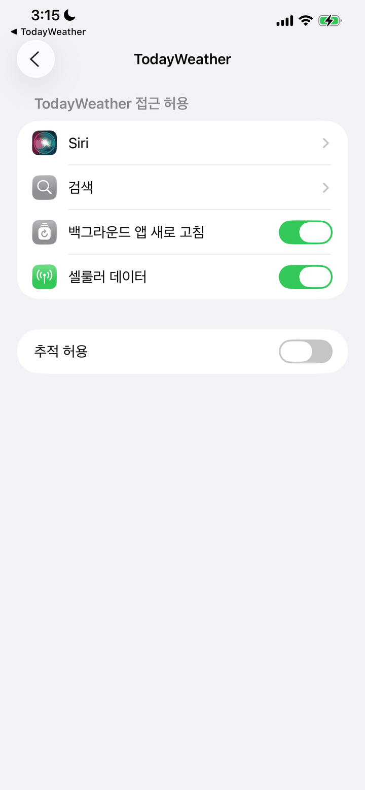

# Change tracking permission on iPhone

When the advertising explanation first appears, tap **Continue**. In the iOS prompt, choose **Allow** or **Ask App Not to Track**. Weather, air quality and notifications are available with either choice.

1. To change your answer later, open the iPhone **Settings** app and search for TodayWeather. If your version shows a tracking permission row in the TodayWeather menu or an **Open Settings** button at the end of a weather page, either shortcut takes you there.
2. In the iPhone settings for TodayWeather, turn **Allow Tracking** (추적 허용) on or off. Confirm your choice if prompted.
3. Reopen TodayWeather. If your version shows tracking status at the bottom of the menu, you can check your choice there.

The menu row may be hidden if tracking is restricted on the device or you haven't answered the first prompt.

