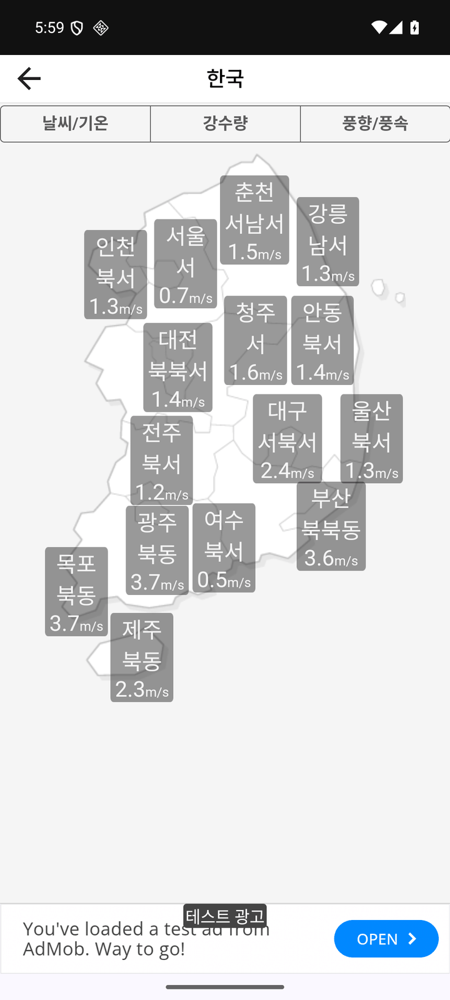

# Compare national weather, wind and air quality

When your device region is South Korea, open **☰** and choose a map.

- **National Weather** (전국날씨) shows sky conditions and temperatures for major cities. Select precipitation or wind direction and speed to change what's displayed on the map.
- **Nation AQI** lets you compare PM2.5, PM10, ozone (O₃), nitrogen dioxide (NO₂), sulfur dioxide (SO₂) and carbon monoxide (CO). Swipe the tab row to reach the last pollutant.
- **nullschool wind** opens an external wind map. To look up a local air monitoring station, use the app's [AQI screen](air.md).

