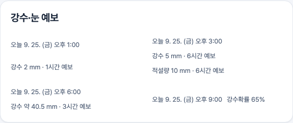

# Read web charts, precipitation and air quality

On the weather screen, choose **Hourly** and select a time to compare temperatures with yesterday. Choose **Show wind and humidity** for more detail. Under **Daily**, check the low, high, and morning and afternoon conditions. With the chart focused, use the arrow keys to move through it or Home and End to jump to either end. Open **Chart data table** to read the same values in rows.

Under **Rain and snow forecast** (강수·눈 예보), probability is the chance of precipitation. If a period is shown next to the amount, the amount covers that entire period. For example, a six-hour forecast gives the amount across all six hours. “About” marks an estimate. A dash (—) means no value was supplied. Check whether a total is an observation from the past or a forecast.

Under **Air quality**, select a pollutant and check the unit. If the station and observation time are shown, check them as well. A **Provider air quality summary** gives the provider's assessment. For South Korean locations, **Weather details** can also show UV and pollen risk by type when data is available.

To compare places, select **Temperature**, **Rain** or **Wind** under **National weather**, or select a pollutant under **National air quality**. **Observations by region** lists the values below the map. Under **Weather alerts**, check the affected areas and publication time. Screens marked as demo data show sample conditions.

