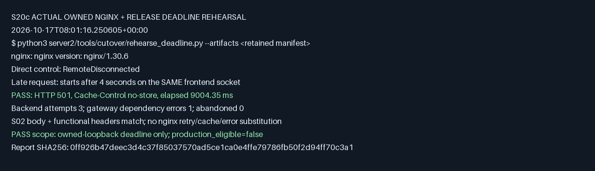
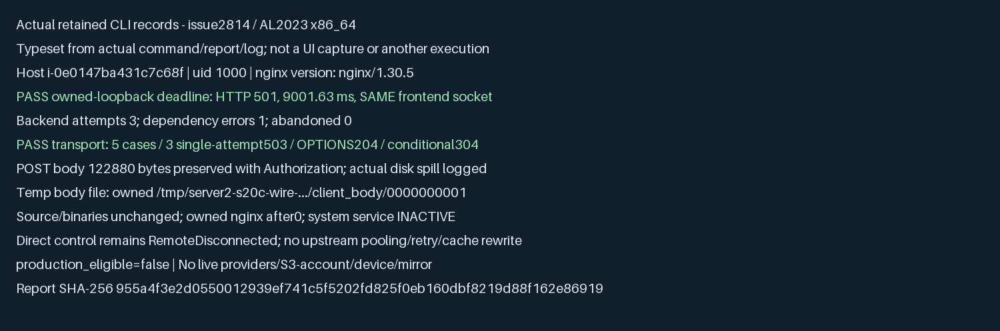

# server2 operational preparation and rollback

This is a candidate procedure for #2704 / #2705. It does not authorize or execute deployment, traffic mirroring, provider calls, state replacement or notification sends. The S20c preparation originated at main `6e4436c8`, with S20a/b process and worker wiring, structured logging and local paired recovery. Later widget and narrative additions are described below; their task records bind their own revisions. [Editable inventory](../../server2/config/cutover/inventory.json) and [decision flow](../architecture/diagrams/server2-cutover.html) accompany this guide. [PDF](server2-cutover.pdf).

## 1. Readiness before a switch

Reconcile all 19 accepted method/path groups (220,583 observed requests), including tiny and failure-only groups, against their exact native contracts. The window is 2026-08-23T19:53:45Z to 2026-09-22T19:53:45Z exclusive. [Accepted traffic evidence](../evidence/aws/api-traffic-2026-09-22.md) is historical, not a fresh routing observation. The later notice endpoint is an explicit backend supplement. App/web notice popup work #2623 remains separate. `/ww` was outside that report, so its volume remains unknown. AK retained widget support on 2026-10-17; `GET /ww/010000/current/2?gcode=lat,lon` is a required native supplement. Use the [widget continuity contract](server2-widget.md), with exact-revision parity and shadow still required. AK subsequently included PR #2805's national/regional `forecastNarrative` in the server2 scope through #2809. Use the [native narrative contract](server2-forecast-narrative.md); this response supplement does not alter the historical 19-route denominator. Its local acquisition/storage/serving proof does not waive exact production parity or qualify an older complete rollback bundle. Existing used special APIs still require their accepted contracts.

| Required evidence | Current disposition |
| --- | --- |
| S19 gateway scenarios, paired CORE/Rich/native family checks | Local evidence exists; keep each corpus, denominator and acquisition differences separate |
| Retained S20c-era native suite | 11 checks including 27 worker cases PASS on retained runtime build; family layers include library, HTTP and coexistence fixtures |
| Paired release recovery | Nine family checks on each release, four API cases A/B/A, 14 mixed-release worker restores and one overlap owner PASS |
| Seven-day paired shadow, exact-revision parity and quota headroom | Not performed here; no invented duration or zero-difference claim |
| EC2 cold p95/capacity/I/O and selected CloudFront/nginx topology | Not qualified by local timings or prior host observations |
| Eligible previous complete release/configuration and durable-state compatibility | Not established by the local paired report; whole-service rollback stays blocked |
| Existing S03 S3/IAM control plane | Read-only recheck: Seoul bucket, versioning, four public blocks and AES256 enabled; runtime profile/role exist; zero attached EC2 observed |
| Final state copy, rainfall handover, instance-role/IMDSv2 and keys | Still require target-specific execution evidence; control-plane existence does not prove runtime access |

The local pair remains `16f3dfde` / `0fc0442d`, not a later build. Worker NativeFetch/clock are injected, and compiled fixtures can refer to the build checkout. Native API rollback covers geocode, partial KMA, world-air and empty notice; it does not prove complete history or notice mutation. World coexistence checks use a frozen legacy double. See [common suite](server2-native-verification.md), [paired recovery](server2-release-recovery.md) and [selected S20c evidence](../evidence/tasks/issue-2705-s20c/verification.md). Do not close S19/S20 or authorize cutover from these layers alone.

## 2. Freeze a release and recovery dossier

Record both candidate and previous release before asking for production approval:

1. Full source revision, build profile/toolchain, executable hashes, build-source mapping for dirty builds and all required assets/compile-time fixture identities. Retain runnable inputs outside disposable build caches. An older filename is not provenance.
2. Exact configuration revision/hash, selected native API families, worker enablement, provider/key references and allowances, S3 bucket/prefix/IAM role, public/private bind addresses, bounded disk-cache root/capacity, upstream routing and listener timeouts. Store secrets separately; record references, never values. Do not invent a new configuration variable or verification mode.
3. Storage/catalog/journal/registration/notice/warning schema compatibility for both directions, including records written after candidate startup. Preserve operation identities and conditional-write semantics. A state test or API-only rollback does not qualify every process capability.
4. A concrete previous server2 bundle that serves every included API with legacy unavailable, plus actual state/worker restore proof, warm/cold/cache-loss behavior and deadline/ETag compatibility under the selected configuration. If any capability or compatibility is unverified, mark the bundle ineligible and keep cutover blocked.
5. Exact target host(s), immutable start command/service definition, routing changes, worker ownership, stop signal/deadline, rollback command, decision maker and action window in the separately approved execution receipt. This guide supplies no SSH, deployment or traffic-switch command.

S3 remains authoritative. Local cache loss or corruption must recover from verified S3 objects, not an old database copy. Keep failed proofs and original receipts. Do not overwrite acknowledged state or edit old build receipts to relabel them onto a later revision.

## 3. Preserve the deadline across reused client connections

The server2 gateway lifetime is 12 seconds. Its nine-second deadline response is guaranteed only when a request starts within the first three seconds of that upstream connection. A client may reuse its frontend connection much later.

The [candidate nginx template](../../server2/deploy/cutover/nginx.conf.template) therefore opens one upstream connection per request: HTTP/1.0 plus `Connection: close`, with no upstream keepalive pool. Frontend keepalive remains 30 seconds. It routes all public paths together, preserves the Host header, disables proxy retries/cache/error substitution and leaves private metrics on the separate private listener. Read/send timeouts are 15 seconds, above the gateway deadline. The template has loopback/ephemeral placeholders and is not directly installable. Production TLS, bind addresses, request limits, access/diagnostic logs and all surrounding nginx includes need their own reviewed target configuration and syntax check. No new proxy retry may duplicate a state mutation.

Run the owned rehearsal with explicitly retained release artifacts and an existing owned nginx binary:

```sh
python3 server2/tools/cutover/rehearse_deadline.py \
  --artifacts reports/my-task/artifacts.json \
  --nginx /owned/nginx --nginx-sha256 SHA256_64_HEX \
  --out reports/my-task/deadline-1
```

The artifact manifest uses the [common suite schema](server2-native-verification.md), requiring `server2` and `loopback_server` beside it under `examples/`. The tool verifies hashes before any child, starts only owned literal-loopback peers, runs nginx `-t` and a temporary foreground process, and inherits no operator credentials or `.env`. It downloads/installs nothing and refuses existing output or output under `server2/`. Use Python 3.9+, nginx 1.19.5+ and a POSIX host. All five standard HTTP module temporary paths are rendered under the private owned workspace; `-e stderr` avoids distro pre-config log paths. Relative, traversing or configuration-injecting workspace/PID paths are refused. Do not grant the test account access to system nginx directories or run the rehearsal as root. The nginx executable is an explicit operator-owned input; this is not an arbitrary-binary security sandbox.

The direct control reproduces the late-request connection close. The candidate first requests health, waits four seconds, then requests weather on the same frontend socket while the recorded backend stalls. PASS requires the real gateway's S02-compatible 501 body and functional headers, `no-store`, approximately nine seconds, exactly three backend attempts, one gateway dependency error and no abandoned response. nginx owns the Server/connection/date headers. The frozen backend and injected roots are declared test dependencies, not proof that a production native-only route needs legacy.

Exit 2/BLOCKED means inadmissible inputs; exit 1/FAIL means execution failed; exit 0/PASS covers this local deadline scenario only. `production_eligible` remains false. Inspect the retained JSON and nginx log, including the failed control, rather than just the exit code. Five additional owned transport-double cases check POST/PUT/DELETE body and authorization preservation with one 503 attempt each, OPTIONS 204/CORS, and conditionalGET 304/ETag. They test proxy transport, not product mutation semantics. All owned processes are stopped. A local PASS does not qualify CloudFront, TLS or EC2 behavior.

## 4. Authorized activation sequence

This sequence is a reviewable proposal. Execute only after the target-specific evidence and separate AK approval above are recorded.

1. Capture the UTC incident/change window, deployed executable/config hashes, route inventory, baseline errors/latency, current claim/result state and [structured diagnostics](server2-logging.md). Confirm the prior bundle remains executable and eligible. An absent log record never proves that a notification was not sent.
2. Complete the final read-only copies of registrations, latest warning bulletins/zone state and kmastninfos through existing S18/S12 tools. Record source cutoff, counts/rejected documents and verified durable restore. Original Mongo documents stay unchanged. Development copies are not the final cutover copy. Never copy the full weather archive or pre-collect cells before go-live.
3. Keep legacy rainfall-statistics updates authoritative until shutdown. Freeze the handover boundary explicitly; only then does server2 own the ported updates. Do not overlap legacy and native scheduled sends.
4. Quiesce ingress/admission and stop new delivery scheduling using the approved target service/router procedure. Signal the old process, wait for bounded HTTP/jobs/acquisition/writer drain, and record accepted, incomplete and unknown outcomes. HTTP-only process stop has 5s drain + 1s runtime; push-owned stop has 34s + 1s. Inspect exit/retained work; do not start replacement workers merely because a timer expired.
5. Confirm the previous worker-owning process has exited and routing/ownership is as approved. Start the candidate with the exact frozen config. Verify durable restore and native-only wiring before admitting traffic. Keep private metrics private. Select `/weather` and `/geocode` as a unit and include direct/push/notice routes in the same deployment inventory.
6. Perform approved non-sending health/API/cache/deadline/state checks. Observe S3 readiness, errors, provider work, queue/drop counters, memory/disk bounds and claim/result invariants. Record actual results before expanding traffic. Do not turn shadow into a pre-collection schedule or send real test notifications.

## 5. Rollback decision and ordered recovery

Keep cutover blocked unless a prior complete bundle is already eligible. Rollback is itself a target-specific production action covered by the approval receipt; this document is not approval.

Abort admission immediately on an unexplained contract diff, missing acknowledged state, duplicate owned delivery attempt, unsafe legacy dependency, invalid artifact/config hash, or broken deadline response. Stop expansion and investigate sustained quota/S3 readiness failure or resource exhaustion. The approved observation window and numeric error/latency thresholds must be pinned before execution: gateway 501 rate must not exceed baseline, p95 must be at most baseline + 10%, at least 99.9% must finish within 9s; assembly-only cold p95 must be at most 2.5s. Do not invent a production sample/window from a small local run. Missing safe evidence is a hold, not permission to switch.

1. Preserve diagnostics and authoritative state evidence. Quiesce admission and new scheduling on the candidate, then use the bounded stop/drain procedure. Confirm it exits before previous workers start. Avoid concurrent old/new supervisors even though the local conditional-claim overlap test has one owner.
2. Start the eligible previous server2 executable **with its paired compatible configuration**. Keep the same authoritative S3 state and durable claims. Do not roll back registration/journal/notice/warning state to an old snapshot; that can erase acknowledged updates and replay a delivery. Do not delete claims, fabricate result records, restore a spent quota block or resend `failed` / `unknown` work. Use existing documented compensation semantics only.
3. If the previous release cannot read the current schema or lacks an included API/worker capability, stop the transition and preserve state. Escalate the incident for an approved compatible repair. Do not silently start legacy, forward to it, or declare unsupported rollback successful.
4. Check restored registration acknowledgement, no increased post count from existing claims, retained unknown outcomes, API status/body/cache/ETag compatibility, cold/cache-loss recovery, bounded deadline response and provider/S3 behavior. Compare against the pinned baseline and thresholds. Record actual executable/config/state identity and routing result.
5. Recovery completes only when the approved checks pass and worker ownership is singular. An accepted FCM request is not device delivery; `unknown` remains unknown. Record unresolved delivery/state uncertainty without retrying it automatically.

## 6. Actual local result and remaining gates



The [selected verification record](../evidence/tasks/issue-2705-s20c/verification.md) pins the actual command, inputs and report hashes. This capture is formatted from that JSON, not production traffic. The required configuration regression and real nginx/release run have different evidence roles. Existing failure, timeout, source and build receipts stay retained.

Current preparation leaves exact whole-inventory production parity (including the retained widget), seven-day shadow, real-host listener/topology/performance/capacity, provider quota headroom (#2724 excluded here), target S3/IAM/IMDSv2 readiness, complete prior-bundle compatibility, final state/rainfall handover and scoped switch/rollback authorization open. Do not mark any as PASS because the local report or PR CI succeeds.

## 7. Actual unprivileged Linux rehearsal

The [2026-10-17 UTC Linux record](../evidence/tasks/issue-2814/verification.md) repairs a real distro-default permission failure that occurred before the deadline assertion. It preserves the original failed setup and separately records the successful nginx 1.30.5 run as uid 1000 on the owned Spot host. HTTP 501 arrived in 9001.63 ms on the same frontend socket; all five transport cases passed. A 122880-byte synthetic POST exercised a logged body spill into the owned temp directory, with bytes and authorization preserved. After stop, no owned nginx process remained and the system service was inactive. This qualifies the declared loopback scenario on that host, not TLS/CloudFront, production readiness or rollback eligibility. Existing retained release binaries were used without a Rust rebuild.



This labelled image renders actual retained CLI reports/logs; it is not an application UI screenshot or another execution. No external live calls, traffic mirror, state copies, device send or production activation occurred.
