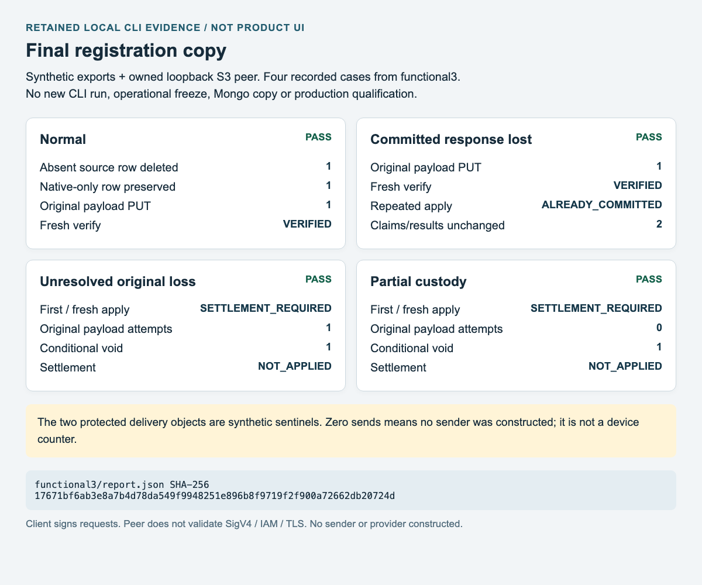

# Final registration copy

This procedure reconciles a complete final legacy registration export into server2, including source-owned registrations deleted from the export. It leaves the original MongoDB documents unchanged. It does not stop legacy workers, freeze editors, export MongoDB, send notifications, deploy a release or authorize a production action.

The implemented commands are `preview`, `apply`, `settle` and `verify`. **Validation and planning are performed by `preview`; there are no separate `validate` or `plan` commands.** Preview and verification read the configured S3 state. Apply and settlement can write it and require separately scoped authority.

See the [CLI source](../../server2/tools/state/push_registration_final_copy.rs), [final-copy contract](../../specs/issue-2819-final-registration-copy.md) and [shared cutover procedure](server2-cutover.md). The final-copy procedure does not replace the cutover gates.

## Before producing a bundle

1. Pin the current release/configuration, source deployment revision and target S3 bucket/region. Obtain dated operational evidence that **every legacy sender process has exited** and **all registration editing ingress is frozen**. Include API, administrative and other editing paths; a Boolean assertion alone is not proof.
2. After that freeze, produce a complete export of **both** `pushes` and `alertpushes`, including explicit complete empty collections. Keep MongoDB read-only. Preserve the original `_id` identities; do not generate replacement IDs to bypass a collision.
3. Preserve the immediately preceding complete baseline, including the imported record identities and content hashes. The final complete-export sequence must increase explicitly and remain at most `9007199254740991`. File modification time is not a sequence. A source deployment revision belongs to the bundle binding; it is not the stable source scope.
4. Bind the stable source ID, Mongo store, database and fixed two-collection scope; target bucket/region and fixed state prefix; baseline and final generations/cutoffs; collection counts and raw/canonical/conversion-report hashes; predecessor and full current native fingerprint. Include content-addressed operational evidence references. Input validation checks their content/binding, not whether the named process really stopped or an ingress really froze.
5. Preserve all original custody files privately. Do not modify server2 registrations between preview and apply. Concurrent native edits invalidate the prepared fingerprint rather than being silently overwritten.

The final-only planner compares the complete baseline with current native state. It removes an absent source row only when its imported ownership and unchanged native document still match the baseline. It preserves unrelated native-created rows and native tombstones. A source-owned row edited natively and absent or also changed in the source is a conflict that blocks the **entire** preview/finalization; it is not skipped while other changes proceed. Retain the error and reconcile a complete authoritative source/baseline under the same stop/freeze gate before preparing a new operation. The error does not report an aggregate conflict count. Incomplete/superseded exports, missing baseline ownership, inconsistent imported records or conflicting identities block destructive planning. Ordinary merge-only import retains its original absence behavior before finalization and is refused after a final-copy marker exists.

## Runtime assets and input limits

Use the pinned release executable named `push_registration_final_copy`. The binary contains the converter/planner/state logic; it does not load legacy source, legacy templates or the synthetic smoke fixture at runtime. The [owned smoke launcher](../../server2/examples/final_registration_copy_smoke.rs) is a verification executable with injected loopback settings, **not** the operational CLI.

Supply private owner-only regular files for `BUNDLE` and `OPERATION`; symlinks, oversized files and reused preview output paths are rejected. The bundle is bounded to 8 MiB and 100,000 rows. Those admission caps do not imply the plan fits: the encoded final journal payload must also fit the default **1 MiB** durable entry bound. Oversized plans block; there is no automatic chunking or replan. Input and marker generations are finite safe integers.

The CLI loads `.env` from its working directory, using process environment values first. Launch from the reviewed server2 runtime directory or use an intentionally configured environment-only directory. Refer to `SERVER2_S3_BUCKET`, `SERVER2_S3_REGION`, `AWS_ACCESS_KEY` and `AWS_SECRET_KEY` by name only; do not copy values into a bundle, command log or manual. Existing S3 settings can use an instance role through IMDSv2 when configured that way. The tool requires its existing durable-state S3 read/write permissions; the local check below does not qualify IAM, credentials, TLS or production data-path readiness.

## Validate and plan

Run only against the intended, authorized state:

```sh
./push_registration_final_copy preview BUNDLE OPERATION
```

`preview` validates the complete bundle, restores authoritative native state, checks the predecessor and prepares a deterministic plan. It creates a new owner-only immutable operation containing the plan/bundle binding, whole native pre-state fingerprint, predicted post-state fingerprint and exact encoded journal bytes, including their nonce. It performs no S3 write.

Review `PREVIEW`, `plan_digest`, `generation`, `journal_seq` and every count. `source_absent_delete` is the count of unchanged source-owned rows missing from the complete final export. It is **different from** the ordinary import `deleted` counter, which counts source rows preserved as existing native tombstones. `native_created_kept`, `native_modified_kept` and `native_deleted_kept` report the protected native cases. Keep the exact bundle and operation; an invalid or stale preview is not permission to alter or discard their binding.

## Apply the original payload once

With separately scoped write authority:

```sh
./push_registration_final_copy apply BUNDLE OPERATION
```

Before the original PUT, the CLI creates `OPERATION.attempt.json` with deterministic hashes of the immutable operation and encoded body. It uses owner-only `create_new`, then fsyncs the file and its parent directory. Existing, partial, unreadable or ambiguous attempt custody does not authorize another original PUT.

The planner rechecks fresh native state and the complete binding. The exact bytes checked against the entry limit are the bytes written and retained for readback. The final change is one conditional entry in the existing journal. A confirmed commit followed by snapshot publication failure remains `COMMITTED` with `snapshot_pending`; do not resend the original payload to fix the snapshot.

Keep bundle, operation, attempt file and resulting receipts together under controlled custody. A missing, lost or copied local attempt file cannot be authenticated globally. The guard does not fence arbitrary fresh library callers or establish process shutdown, editor freeze, write authority or production eligibility. Uncertain custody requires reconciliation; deleting/resetting the file or creating a copied/new operation to retry bypasses the intended protection.

## Settle unknown without resending

For `SETTLEMENT_REQUIRED`, preserve the immutable operation and all failure evidence. A fresh-process repeated `apply` with retained attempt custody performs read-only observation; it does not resend the original payload. Use explicit settlement:

```sh
./push_registration_final_copy settle BUNDLE OPERATION
```

Settlement uses the existing journal readback and conditional-void protocol only. It may recognize the exact committed bytes or, after checking the native base and next sequence, conditionally fence an absent original with a **distinct void**. It never submits the original final-copy payload again. A failed read or uncertain void remains `SETTLEMENT_REQUIRED`. Repeating settlement after a retained void returns `NOT_APPLIED`, including a lost void response, without another original or void PUT.

`NOT_APPLIED` is a fenced absence outcome, not permission to replay the same plan. Resolve `STALE` or failed settlement and any newly required authorization before preparing another operation. The library also refuses another apply while the same `Durable` owner has an unsettled attempt; this in-memory guard is not a global fence across arbitrary new callers.

## Verify and preserve recovery ownership

```sh
./push_registration_final_copy verify BUNDLE OPERATION
```

Verification performs a fresh authoritative restore and requires the exact journal bytes and canonical source marker. At the operation sequence, `VERIFIED` also requires the predicted full native post-state fingerprint. Later native changes can yield historical `COMMITTED`; that is not a claim that current state still equals the old predicted state. A successful repeated apply may report `ALREADY_COMMITTED` with no additional PUT.

The marker belongs to canonical `State` and optional journal **header** / snapshot **head** metadata. It is not a snapshot record line. Service catch-up, native edits and compaction carry it. Unmarked serialization remains unchanged. Older writers that discard this metadata are **ineligible after finalization**. No old compiled-binary reader/writer compatibility is claimed by the local check. An eligible recovery pair requires two genuine post-F1 releases/configurations that preserve the marker and pass their own qualification.

Retain the same authoritative S3 state and durable delivery ownership. Never rewind a journal/snapshot, restore an old registration state over new native edits, drop claims, or replay failed/unknown notification sends. Do not qualify a previous full bundle from a registration-only check.

| Result | Meaning and next action |
| --- | --- |
| `PREVIEW` | Validation/plan prepared; review immutable files and counts. |
| `COMMITTED` / `ALREADY_COMMITTED` | Exact commit recognized; perform verification and retain receipts. |
| `VERIFIED` | Fresh state at this operation sequence matches the predicted result. |
| `SETTLEMENT_REQUIRED` | Preserve custody; explicit readback/conditional-void settlement only. |
| `STALE` / `NOT_APPLIED` | Stop; reconcile the exact outcome before any new authorized plan. |
| Exit 0 | Preview succeeded, or a recognized commit/verification result. |
| Exit 1 | A receipt requires operator resolution. |
| Exit 2 / `BLOCKED` | Invalid usage/input/configuration or a failed invariant; no permission to bypass it. |

## Retained local evidence



This is a headless-Chrome capture of a **labelled evidence view**, generated from the retained current `functional3` report and real CLI receipts. Capturing it did not rerun the CLI. The earlier functional2 capture and report remain historical evidence. It shows synthetic exports and an owned loopback S3-compatible peer; no live MongoDB, sender, provider, actual freeze, final production copy or deployment was involved.

| Recorded case | Observed outcome |
| --- | --- |
| Normal | One absent source row removed; one native-only row preserved; exact payload PUT once; fresh verify; repeat apply writes nothing. |
| Committed response lost | Existing readback recognizes commit; original payload remains one PUT; fresh verify and idempotent observation. |
| Unresolved original loss | Fresh repeated apply stays `SETTLEMENT_REQUIRED`; original payload attempted once total; settlement writes one conditional void and yields `NOT_APPLIED`. |
| Partial custody | Both applies stay `SETTLEMENT_REQUIRED`; original payload attempted zero times; explicit settlement writes one conditional void. |

Two synthetic delivery claim/result sentinels remained byte-identical. A reported zero-send condition means no sender/provider was constructed; it is not a measured device counter. The client signs requests, but the peer does not validate SigV4, IAM or TLS.

Report SHA-256: `17699e631f50df6d5d86c5d37c5a3113115d82cd5b221c2495deb838445550bb`.
Release CLI SHA-256: `8924ad0b704e0d4a2d7e54f0179dc7fd5fa38a342c9a92c927f60a53c5295fe4`.
Owned launcher SHA-256: `aa6d05eeff9bc0310ec7c8d8f61e47ac0a1435e4272d7270d75c827460a69a8f`.

The source binding is base `c1ae9082b2c86f0087727be9872b0cf82b4e3bb1` plus the retained dirty-source verification map; these hashes are not a claim that an unmodified base binary was exercised. Operational sender/freeze/export evidence, real cloud readiness, eligible full release recovery, final registration copy and cutover approval remain separate gates.

### Marker-erasure boundary

A claimed predecessor chain detects erased or mismatched marker metadata. If both restored state and the supplied bundle omit a predecessor, the tool cannot distinguish a first finalization from metadata erased by an old writer. A read-only regression pins that limit; it does not make such a writer eligible. Preserve custody and use only full releases that retain the marker.

### Current reviewed correction evidence

The repeat-settle regression first failed with STALE instead of NOT_APPLIED. Current state/delivery/runtime regressions pass191tests (4ignored), focused18 included in state48, all-target Clippy and actual fmt--check pass, and current optimized functional3 repeats the four owned CLI cases plus fresh-process repeated settlement. Cross-owner seq-1 compaction followed by a failed final snapshot and cold journal replay preserves the complete state fingerprint, rows/import digests/order/next_n/tombstones/marker and sentinels. No old binary, IAM or whole-release recovery was tested. Historical fmt6 changed source; it is separate from the final actual check and does not describe the current candidate.
