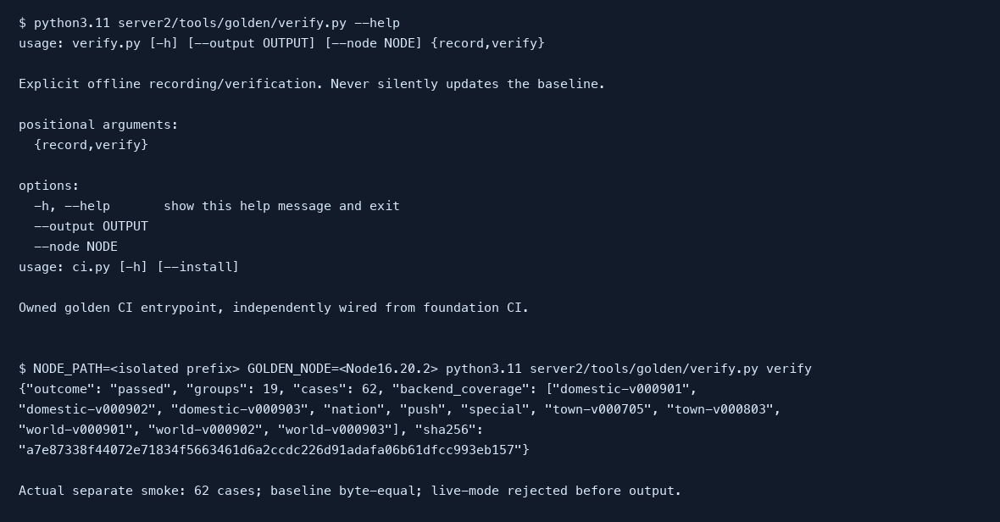

# Offline golden recording and provenance

The original S02 developer tool records actual legacy handlers without starting the service, MongoDB, collectors, live providers, geocoders or notification sends. The S02 procedures below remain its standalone contract; the [current G1 boundary](#current-g1-qualification-boundary) covers the additional recorder families and provenance audit. Neither tool certifies the deployed service.

## Prerequisites and safety

Use Node **16.20.2**, Python **3.11+**, and npm compatible with the checked-in lock. The legacy dependencies are deliberately pinned for this test process, not proposed as production dependencies. i18n 0.8.3, async 2.6.2 and xml2js 0.4.19 match the source baseline lock. Pinning these from the initial oracle versions changed zero body/status/header values across all 76 cases; the lock and runtime provenance still change explicitly. Work from the repository root. The isolated dependency installation uses network access to the package registry; handler execution admits only explicitly registered local 127.0.0.1 HTTP ports. Run in a clean, non-secret environment. Do not start `server/app.js` or any `/gather` endpoint.

For standalone S02, the only outside executable is the declared `server/test/offline/golden-record.js`. Its server2 consumer validates that exact canonical path and hash before spawning it. G1 additionally uses individually declared, byte-preserving recorder exports inside the qualified boundaries below. These verification exceptions are not server2 runtime imports or permission to execute arbitrary outside files.

## Verify the baseline

The independent golden CI entrypoint creates and removes a temporary dependency prefix. It installs with lifecycle scripts, audit and funding requests disabled, runs negative contract tests, and records twice in fresh Node processes:

```sh
python3.11 server2/tools/golden/ci.py --install
```

This standalone CI path requires its two recordings to match each other and the checked-in `server2/tests/golden/records.json` byte for byte. Its historical completed verification reported 19 observed groups, 76 actual wire cases and 11 backend families. The current G1 baseline was recorded through the qualified rest boundary; equivalence of a fresh standalone `ci.py`/`verify.py` run remains part of the existing current-CI gate, not a result established by schema validation or by the guarded pair alone. Missing coverage, altered raw bytes, status, headers or source/dependency hashes fails verification. The artifact keeps response bodies in base64, so JSON whitespace and non-JSON bodies are preserved.

For an existing isolated install, explicitly set its node_modules prefix and Node executable:

```sh
NODE_PATH=/tmp/my-golden-deps/node_modules \
GOLDEN_NODE=/path/to/node-16.20.2 \
python3.11 server2/tools/golden/verify.py verify
```

The following capture is from actual CLI help and a completed offline verification; host-specific paths are omitted from the capture. The PDF version contains the same procedure and evidence.



## Inspect or deliberately update a baseline

Recording requires an explicit output directory. Both consumer and direct recorder reject the committed golden directory, child paths and symlink aliases, so an explicit record cannot overwrite the baseline:

```sh
NODE_PATH=/tmp/my-golden-deps/node_modules \
python3.11 server2/tools/golden/verify.py record \
  --node /path/to/node-16.20.2 --output /tmp/my-golden-review
```

Review that output against the committed artifact, including provenance, request, raw body, status and every header. A source or fixture change requires explaining the actual contract change and independently reviewing the new recording. Copy an approved recording into the baseline only as an explicit source change, then repeat verification, placement and CI checks. The recorder pins the source baseline revision rather than using the current Git HEAD, so committing tooling does not change output.

## Coverage and interpretation

The accepted 2026-08-23..2026-09-22 UTC traffic CSV has 220,583 requests in 19 method/path groups. It establishes inclusion only. Supplementary cases exercise the real domestic v000901/v000902/v000903 and world backends, town, nation, warnings and push assembly; gateway stubs do not substitute for those cases.

All six master locales and requested temperature, wind, pressure, distance, precipitation and air unit variants execute actual controllers. Gateway success cases carry the app unit query, airForecastSource=kaq and Korean Accept-Language; a duplicate-key, plus-encoded and invalid-pair case freezes query normalization. World captures cover all six locales with an additional SI unit set. Production getJson parsing/timers execute against real registered loopback backend servers, including JSON text with a non-JSON content type. The harness injects the loopback URL; it does not execute the production host-config constructor. Cases include OPTIONS, actual ETag/304, malformed inputs, geocoder auth/quota/empty results, non-JSON gateway errors, yesterday/midnight, missing history, covered/missing/old-row POP, week-old warning types 2/3 and type 4's actual 19-hour boundary. Exactly +19 hours is included; +19 hours plus 1ms is absent in the frozen legacy behavior.

Additional cases capture actual 503/Retry-After, excluded and normalized-zero 404, the default 9-second deadline, and nation/special ETag/304. Resumed-after-eight-days input contains 24 timestamped old rows on September 15, an eight-day gap and a September 24 current slot. It is distinct from never-requested input; actual controllers decide which old rows survive.

Failure-only v000705 POST push and v000901 nation use fixed dependency failures through real handlers. The request timeout Error has code ESOCKETTIMEDOUT and no HTTP status: the nation handler returns 500, not the historical CSV 502. The cause/layer of that historical 502 is unknown; it is not a handler oracle. The push failure text is a synthetic fixture err.message, passed through by the actual handler; its literal wording is not evidence of the historical failure cause. A separate successful fixed-store POST records the legitimate 200 handler behavior. The gateway non-JSON failure body and unavailable marker are also explicitly synthetic dependency inputs.

The current v000705 town route, including its real version index, produces an empty 200 with the frozen inputs and has no ETag. Historical traffic 200 does not establish its payload. These limitations are explicit, not synthetic success fixtures.

The original S02 logical revision label is `f568508da68d408a282752f55614407899631c88`, including the legacy #2684 push recovery changes. That label remains in the current record; actual G1 inputs are identified by the renewed per-file hashes against the a6 base and declared candidate exports. The label does not claim those inputs are the original f568 tree. AK's future server2 no-resend and new-registration-only decisions are recorded separately as intended differences; legacy goldens are not silently rewritten to encode them. Source/deployed revision drift remains a cutover gate.

## Failures and limits

A raw-body/hash error, inventory gap, source drift or byte mismatch exits nonzero. Inspect an explicit fresh recording rather than automatically accepting new bytes. Missing Node/dependencies or denied local sockets is an environment failure, not a parity result. Automated child-process tests reject live-mode hints and legacy/committed output paths before writes. Startup assertions reject unregistered/external sockets, DNS, HTTPS, UDP and child execution before IO. The consumer strips host provider/storage hints and never uses them to fetch data.

Dependency responses are fixed inputs and some existing offline fixtures are synthetic. Real assembly and HTTP middleware execute, but this does not establish provider availability, production credentials, every geographic location, concurrent locale races, complete deployed parity or a new server2 response. The JavaScript guards are a bounded verification safety mechanism, not an adversarial OS sandbox. Resource placement checks supplement manual review and do not prove arbitrary computed paths safe.

The foundation workflow retains fmt, clippy, Rust tests, placement tests, release build and separate release-binary smoke. The additive golden job invokes only its owned CI entrypoint. Essential golden bytes, selected CLI capture and this editable/PDF manual are retained in Git; raw stage runs remain ignored local reports. No broad reports upload is added.

The CI event filter is unchanged. Ordinary legacy-only maintenance does not require a server2 task declaration or run this workflow. A later golden invocation detects source drift; this oracle is not continuous legacy drift enforcement.


## Current provenance domains (build23, 2026-10-20)

The bounded audit separates 187 tracked product/reference paths from 33 named verification exports. These counts come from the unchanged reader's 190 fixed keys minus its three declared air/delivery exports, plus 30 additional actual source-map export references in the full22 corpus. The export list is exactly the intersection of declared oracle exports and registered map references; a prefix alone grants no permission. Product paths still require Git tracking.

The pinned Node hash-only reader is unchanged and owns the three original export hashes. Additional exports use bounded regular-file reads with symlink rejection, per-file and aggregate caps. The report exposes both domains separately. Full22 `source.files` bytes are retained exactly; historical `helper_files` aliases are not rewritten into current paths. The registry retains 22 fixtures and 23 maps.

A preexisting preparation defect had already left registry/reader at190 while the checker still required189. Build23 records that baseline rejection separately before repairing the domain contract. `SOURCE_CURRENT` still means source freshness only. Remaining DRIFT must receive actual current replay and semantic disposition; no automatic digest renewal is allowed.

## Current-source whole-record renewal (build24, 2026-10-20)

Two separately guarded recordings per group produced identical complete document and gzip bytes. The adopted bytes are the second actual recording in full; no source field was patched into an old record. All 20 typed differences across towns, nation and four delivery groups are source metadata (2 + 2 + 4 × 4); body, status, headers, trace and ordering differences are zero in this corpus. Node is 16.20.2 (binary SHA256 `83325958463d59cb0b16433eefab0a03fd1ce7d565a27e0274f507b1f3839a6e`), TZ UTC.

The delivery `source.revision` value `a6fdf1f4d1f869d63c5310646003967571dac6e2` identifies the base commit. Execution also used candidate files, including untracked named recorder exports and existing G1 changes; the actual inputs are identified by per-file SHA256 in the records and guarded policy inventories. This is not a clean-checkout recording claim. Old fixture bytes and all capture/receipt/comparison histories are preserved in the local build24 evidence. Freshness and native acceptance are verified separately after adoption.

| Group | Preserved predecessor SHA256 | Adopted actual2 SHA256 |
| --- | --- | --- |
| towns | `6cda47a8ee024772e56f68963b1cf0285999cfd9ad17cef786bf23ac8aa90413` | `6e90364d7c3f3d8dc4f115e6b7af19d7eb9ba4008cd4e7a7304c6ff4f71cd945` |
| nation | `19b186ccf035ecc40fcb34063b8e92bce6d2795f64f209a89a8c74d1847cf3cc` | `ced3f9e1939a2e02ee9bef48b4ca1f10ca794959b48051efd9bffa5c3636caa3` |
| delivery-alarm | `12bb87443367b4f9b4e2726a71e19e140ce25b7aa0b8bfb3c54990d8f33394c6` | `ee4bb8055cb8a36d28ff6e89c49348cf14811070e61f24cd88bc8df17a50ecba` |
| delivery-alerts | `603abff1b1db40285fb38fe062628c97b6a07549a015adc0c85ce37c20d3f0a0` | `139259f4ba1db02c2834e0bc67291f210c99d39046deb4614211dfbf51110d52` |
| delivery-malformed | `10de484d8e39a89a10350d338c34eafe83bc6268ade35279d294122af9d6d327` | `6d6ffcbbd356f25c04fb9aa61809ef502bf5b895f07cca7891f5628768105a89` |
| delivery-air-filter | `fc6f0e3e740b0bf4e5bc09bb0c250ac552abd17f3e48f6ffffe9604102b42d68` | `caaa0645ed775cc186677e2babfa216f757126c25be315b7d5ecb161448001a5` |

Pinned dependency locks (npm lockfile format and exact direct versions retained):

- SHA256 `056c59c13b4c65c3aa945d1031afac0d5435aabfa78b91549c4efcb2babc88a8`, lockfileVersion 2; direct dependencies: `mongoose@5.1.2`.
- SHA256 `c34d3d5f2cf6290283c11ad82a53774c5ecf63a4f41550d491b03ee29d305b1e`, lockfileVersion 3; direct dependencies: `mongoose@5.1.2`, `async@2.6.2`, `jade@1.11.0`, `i18n@0.8.3`.
- SHA256 `4e00cbb69b10b72a1a0b1470e98aeca15c16ae9776ee39f7d0cc1a2de7d18c8e`, lockfileVersion 3; direct dependencies: `async@2.6.2`, `body-parser@1.20.6`, `cheerio@0.20.0`, `cookie-parser@1.3.5`, `cors@2.8.5`, `express@4.13.4`, `express-session@1.15.6`, `i18n@0.8.3`, `sprintf@0.1.5`, `xml2js@0.4.19`.
- SHA256 `aebc9e020a7521cc3cea5f63b7f526f3e19e499c3f22f0faa80f58056c403bd9`, lockfileVersion 3; direct dependencies: `firebase-admin@5.13.1`.

Raw build24 receipts are local evidence, not a published CI or whole-G1 PASS. Remaining S02, world and widget qualification and original G1 gates stay open.

## G1 current-source whole-record requalification (build24, 2026-10-20)

This is a new whole-corpus G1 qualification, distinct from the historical S20d recorder-extension step above. Three groups were each recorded twice under the sibling rest_http boundary; complete raw documents and output files match exactly within each pair. Adopted fixtures contain the whole second qualified output, with no digest patched into an old record. The first failed world attempt remains UNQUALIFIED and was not used for comparison or adoption.

S02 has three current file SHA changes and twelve middleware implementation SHA changes (six unique literal functions). The recorder hashes `original.toString()`; hashing exact current controller source spans reproduces all twelve values. Old function preimages were not recovered. Responses, status, headers, ordering and all other trace fields are unchanged across this corpus; this does not assert semantic equivalence of the changed functions for arbitrary inputs. World and widget each have two current source-file SHA changes and no other document differences.

Canonical recorder bytes and historical logical revisions remain unchanged: S02 `f568508da68d408a282752f55614407899631c88`, widget `82f7a4838dda046be966ee9c25c9cb66561d099d`. The execution base is `a6fdf1f4d1f869d63c5310646003967571dac6e2`; candidate files, including the declared byte-preserving world export, are identified by their individual hashes, not a clean-checkout assertion. Original scenario clocks, inventory, case order and producer deadlines are retained. The parent120s safety bound is separately disclosed; no original deadline was extended.

Widget packaging is an explicit current decision: gzip level9, mtime0, with decompressed bytes equal to the actual original JSON output. This does not claim reconstruction of the historical compressed preimage. World retains its original Node gzip output; S02 remains uncompressed JSON.

Node16.20.2 SHA256 `83325958463d59cb0b16433eefab0a03fd1ce7d565a27e0274f507b1f3839a6e`, UTC/production; canonical recorder SHA256 `cdadca2821384885388e0a36a20883273735f7c325837bc80a8dd9e381c5ac46`; dependency lock SHA256 `18caa49d992431a51c255b8560870385e1e698177e5cdf89cb81bc21df6ce8b3`. Isolated installed inventory contains4470 regular files and retains the exact locked dependency tree.

| Group | Preserved predecessor SHA256 | Whole actual2 fixture SHA256 |
| --- | --- | --- |
| s02 | `997e0f8ea76cda2de7a2cb5e142bead9a1f876d9f93ee6037b1ab8a17d1e0a0d` | `a95f78a100f5b048b05a59b67f4213e268bd4fc3346ead20c4f5f81c05e83fdf` |
| world-locale | `54825f967c5cd422fd9b625e8c863ab6c519657697f944198ba22524f92fe864` | `502d80524cf6b829226dc07c4f6b31fda078f20a21c170ab208a4ee261f79e76` |
| widget | `f70690200e6d83ad20268f0702a544ef0bf97ceba585999241c9c4840b9c324e` | `2b6e0b639077960fa7a08f44580cc5787b4ef738e32dfc265d13fbccaf8a6015` |

All prior fixture bytes, histories, failure receipts and the complete world-driver code fence are preserved. Post-adoption freshness/native validation is required separately; these recordings alone do not establish G1 PASS, current CI, independent PR review or final candidate placement.

## Current G1 qualification boundary

The registry contains 22 fixtures and 23 explicit source-map pointers. Its two
identity domains are 187 tracked product/reference files and 33 verification
exports. The unchanged Node reader returns 190 keys: the 187 product files plus
three declared exports. Python hashes the other 30 referenced exports with
regular-file, symlink and byte limits. Export permission is the exact
intersection of declarations and actual map references; a directory prefix does
not grant access. Neither checker evaluates a legacy module.

Run the read-only freshness audit with a verified Node 16.20.2 executable and a
new ignored report directory:

```sh
python3.11 server2/tools/golden/provenance.py \
  --root "$PWD" --node "$PINNED_NODE" --out reports/golden-current-audit
```

`PINNED_NODE` names the separately verified executable; it is not a version
selection mechanism. A `SOURCE_CURRENT` report means registered source identities
match current bytes. It does not establish response parity, current provider
behavior or approval to renew fixtures. `DRIFT` requires qualification and
complete difference disposition; changing old source hashes alone is forbidden.

The maintained launchers implement separate fixed recorder contracts:

| Corpus | Launcher | Boundary |
| --- | --- | --- |
| Towns | [replay_towns.py](../../server2/tools/golden/replay_towns.py) | towns guard and policy |
| Nation | [replay_nation.py](../../server2/tools/golden/replay_nation.py) | nation guard and policy |
| Air inputs | [replay_air.py](../../server2/tools/golden/replay_air.py) | air guard and policy |
| Delivery variants | [replay_delivery.py](../../server2/tools/golden/replay_delivery.py) | delivery guard and policy |
| KMA, older, town, core and rich | [replay_domestic_http.py](../../server2/tools/golden/replay_domestic_http.py) | existing domestic_http guard and policy |
| S02, world and widget | [replay_rest_http.py](../../server2/tools/golden/replay_rest_http.py) | sibling rest_http guard and policy |

A launcher requires exact source/export/static-input hashes, a verified isolated
dependency inventory, fixed Node identity and the profile's original clocks and
recorder deadlines. `--record` requests execution; it does not grant task
permission. Prepare and review the exact profile, output names, parent log/exit
paths and write scope before running an original recorder. Keep guard/policy
bytes frozen through a pair. A failed preflight prevents child invocation;
postchecks still run after child failure. Retain complete stdout/stderr, exit,
guard evidence, reaping and owned-process absence. Unexpected actual outcomes
stop dependent execution for diagnosis; do not silently reuse or allocate an
output name.

The rest boundary preserves the original producer argv and fixed clocks. It
allows only exact inputs and owned loopback HTTP operations; provider, database,
startup and background access remain denied. It is a trusted-producer API
boundary, not an OS sandbox. The canonical S02 producer replaces selected denial
functions with its own stricter canary functions: those probes exercise the
producer's boundary, not independent guard interception. The rest guard still
constrains listen/connect ownership and audits modules, VM code and filesystem
access.

Pinned i18n 0.8.3 probes six locale `.js` names before selecting the admitted JSON
files. Each rest profile permits metadata checks on exactly those six names;
this adds 18 policy entries across the three profiles. Reading a `.js` file,
following it as a module, changing it, or probing an unlisted locale remains
denied. SDK controls verify JSON selection and file/symlink/private-read refusal
using inert replicas derived from the reviewed source map. They do not execute
original application handlers.

For renewal, preserve the old complete fixture first. Capture the entire
original corpus twice, require exact pair document/file bytes and packaged gzip
bytes where applicable, and classify every typed/key-order difference against
the predecessor. No response, dependency trace, body, source field or ordering
is silently excluded. Adopt the whole qualified second output with its source,
dependency, comparison and receipt hashes; then update its registry hash and
provenance together. Widget packaging explicitly uses gzip level 9, mtime 0,
and must decompress to the original recorder's raw JSON. This is a current
packaging decision, not reconstruction of a historical compressed preimage.

After adoption, repeat the freshness audit and affected native/functional tests.
The 2026-10-20 local result was 22 `SOURCE_CURRENT` / 0 `DRIFT`; affected native
harnesses passed 322 tests with three preexisting ignored tests (two slow sweeps
and one separate owned flow), and 18 golden
contract tests passed. The previous parallel domestic failure and resource Red,
first UNQUALIFIED world capture, and setup/gate failures remain preserved. Of the
seven original rest invocations, one was UNQUALIFIED and six formed the three
qualified pairs. Source freshness, corpus parity, final candidate placement,
artifact policy, current CI and eligible independent PR review are separate
gates. Local results do not establish whole-G1 or merge readiness.

The schema check also matched the canonical recorder hash, dependency lock hash
and complete inventory. These post-adoption results supersede the earlier
pre-adoption open-state paragraphs while preserving their historical facts.
The current standalone golden CI equality check and eligible PR review remain
pending; the guarded recordings and local validators do not replace that job.
