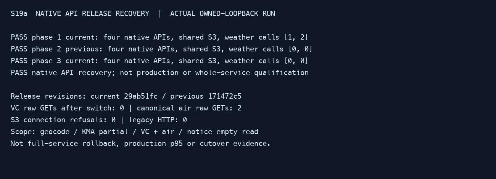

# Native API release recovery rehearsal

S19a exercises two explicitly identified `loopback_server` release examples from
server2 revisions. All three phases select native weather and geocode. No legacy
URL, private `.env`, real provider credential, AWS endpoint or notification worker
is used. This is an offline API contract rehearsal, not a deployment command or
whole-service release qualification.

## Prepare the pair

Build each revision's existing `server2/examples/loopback_server.rs` in release
profile. Preserve the executable outside Cargo target before building the next
revision; hash the actual preserved bytes. Reusing the same target between
worktrees can leave a stale output even when Cargo reports it fresh. Validate the
pair hashes and retain build/source provenance; use the coordinated target lease
and clear only eligible package output when necessary. Never accept identical
binary hashes as two-release recovery evidence.

Create a private local manifest under ignored `reports/`:

```json
{
  "schema": 1,
  "artifacts": {
    "current": {
      "path": "/absolute/current",
      "sha256": "64 lowercase hex",
      "revision": "40 lowercase hex",
      "profile": "release"
    },
    "previous": {
      "path": "/absolute/previous",
      "sha256": "64 lowercase hex",
      "revision": "40 lowercase hex",
      "profile": "release"
    }
  }
}
```

Both files must exist and be executable; all revision/hash fields must have their
full exact length. The tool verifies hashes before and after execution, but the
revision and profile are caller-supplied build provenance. Retain the source tree,
commands and build receipts; the manifest is not independent source attestation.

## Run and inspect

From the repository root:

```sh
python3.11 server2/tools/shadow/native_rollback.py \
  --artifacts reports/native-recovery/artifacts.json \
  --report reports/native-recovery/result.json
```

The fixed sequence is current → previous → current, with fresh RAM, the same
owned S3 peer and disposable disk root. Four native API cases run cold and warm in
each phase. The first phase collects one London VC cell and two separate air cells (Seoul domestic fallback and London), once each; subsequent
phases keep those provider stubs unavailable and require zero weather/air
reacquisition. Recorded native geocoding remains available; its calls are counted
separately and exact-coordinate results are not persisted. Native KMA exercises
its partial/missing-data response, and notice exercises its empty read response.
Neither is evidence of complete historical data or notice mutation rollback.

Each response must preserve exact status, body bytes and the union of functional
headers. Date, connection/keep-alive and server headers are transport differences;
ETag, Cache-Control, Content-Length and Vary are checked. Cross-phase conditional
requests must return 304 with an empty body for geocode, KMA-partial and world-air
on both restored phases. Each of these three APIs must retain a nonempty ETag;
matching missing validators fail. Notice-read remains exempt. Unexpected response drift fails; clock-boundary drift is not normalized or
silently retried. Every phase must stop cleanly.

VC raw must be reused from the verified disk copy across release changes. The two air raws are excluded from disk by the existing privacy policy and are read from authoritative S3 on each restart; these are not provider calls.

The report records artifact hashes/revisions, observations, provider/S3 counts,
metrics, actual sample percentiles and limitations. These tiny owned-loopback
samples are not EC2 cold-p95, quotas, CloudFront cache behavior or live shadow.

## Qualification boundaries

A passing API rehearsal does not make the earlier revision safe for the whole
service. The chosen prior revision must independently cover the complete S20 API
and worker inventory, state formats, one-shot delivery claims and operational
configuration before production rollback is approved. This tool does not verify
push workers, warning delivery, summaries, state mutation compatibility, Spot or
CloudFront. Existing canonical CORE/Rich replay and worker/state failure suites
remain separate required checks. S19 stays open for integrated family coverage;
S20 owns actual release eligibility, performance and approved activation.

An unsupported scope, invalid artifact pair, response mismatch, provider work
during restore or unclean stop is a failure. Never fall back to legacy or remove
a failed assertion to declare readiness. No production configuration is changed.

## Selected local result

The actual release-pair rehearsal passed three phases with four cold and four warm API responses per phase. Both restored phases made zero weather-provider calls and observed zero test-peer connection refusals. VC raw used the retained verified disk file; two air raws were read from S3. The default test-peer connection lifetime avoids persistent idle sockets occupying its unchanged16 slots. No production transport change was made. See the [selected verification](../evidence/tasks/issue-2704-s19a/verification.md) and actual output capture below.


