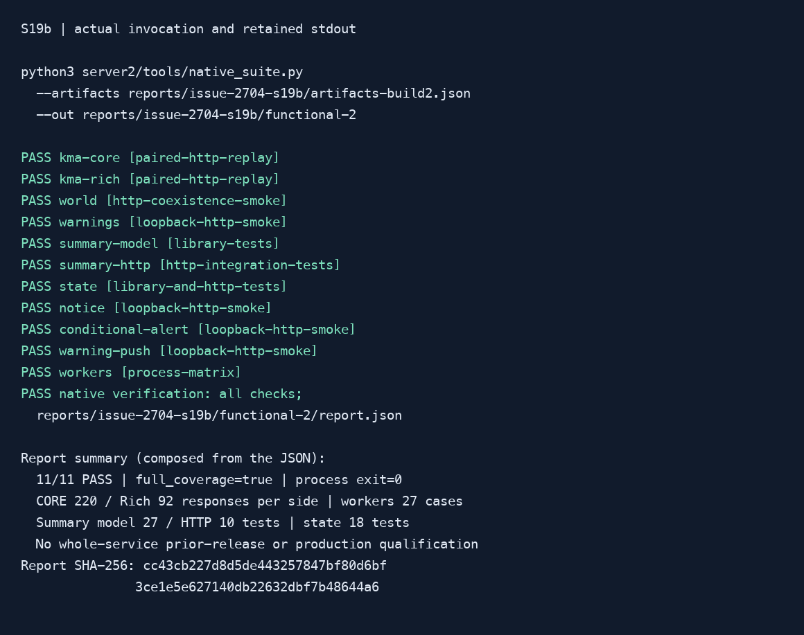
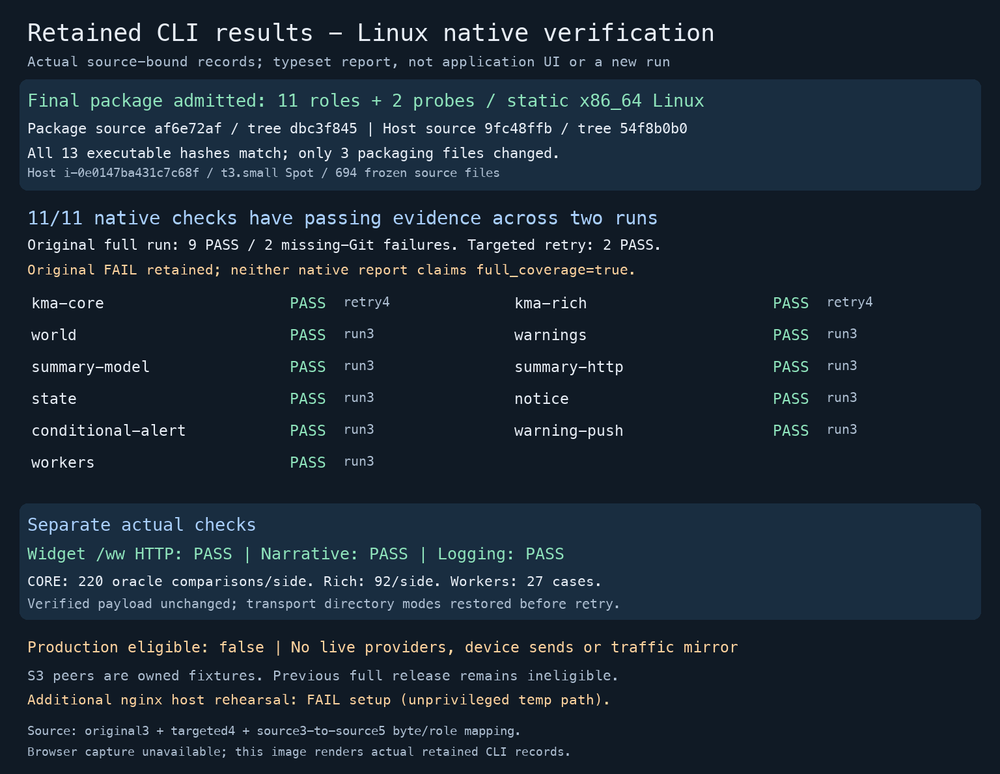

# Common native verification

Run the existing verification layers through one fixed command. The default selection has 11 checks. A successful subset remains a subset, and no suite result qualifies whole-service earlier-release recovery, live traffic parity or production activation.

## Prepare artifacts

### Retain the Linux verification bundle

On a clean reviewed Linux checkout, run from `server2/`:

```sh
python3 tools/native_artifact.py --target-dir target --output ../reports/linux-native --archive ../reports/native.tar.gz
```

The producer reuses the selected Cargo target, builds sequentially, and requires
3 GiB expected build space plus a 3 GiB reserve. It selects compiler-emitted
release executable paths for the eleven roles below and the logging/narrative
probes. It exports `bin/`, `source/server2/`, `artifacts.json` and `bundle.json`.
Only regular tracked server2 source and fixtures are copied; installed packages,
ignored caches and account files are excluded. The optional archive contains a
`native/` directory, including hidden tracked inputs and directory/executable
modes. CI retains `native.tar.gz` inside the existing
`server2-linux-musl-verified` artifact; the shared upload is unchanged. Compare
the archive SHA-256 with the trusted producer/CI receipt before extracting it
into a fresh owned directory. The original
two-binary export remains unchanged. Seven-day CI retention is transport only;
retain selected executable inputs and reports before expiry.

Check `python3 --version` (3.9 or later) and `git --version` on the receiving
host. The paired replay records revision metadata using the Git executable even
when the copied source has no Git checkout; an absent Git executable blocks that
report. Run checks as an unprivileged account. After transfer to a fresh owned directory,
restore executable permissions on the thirteen declared files if the transport
stripped them, and preserve the exported source tree's read-only permissions.
Run `chmod -R a-w BUNDLE/source` after transport and before verification;
archives that omit directory entries and ZIP transports can lose directory modes.
Python cache files must not become extra executable inputs. Run:

```sh
python3 BUNDLE/source/server2/tools/native_artifact.py --verify BUNDLE
```

Replace `BUNDLE` with the actual directory. Verify the trusted build receipt's
revision, server2 tree and bundle metadata hash as well: these JSON hashes detect
changes against that receipt, but are not signed attestations. Missing, changed,
extra, symlinked, foreign-architecture or dynamically interpreted payloads block
verification. Exit 2 is BLOCKED. No verification command installs files or starts
a product process.

Rust integration tests retain `CARGO_MANIFEST_DIR` from compilation. Inspect
`compiled_source_root` in `bundle.json`. On the empty owned host, map that exact
location to `BUNDLE/source/server2` before execution; this is explicit operator
setup, never a manifest-driven installation. Stop if the exact destination already
exists, including a symlink; never overwrite a checkout or another run's mapping.
A newly created symlink or bind mount to this bundle is allowed. Local container
builds record `/work/server2`; CI builds normally record
`/home/runner/work/TodayWeather/TodayWeather/server2`. Creating those parents can
require privileged operator setup, but run verification itself as the ordinary
user. For example, after checking that `/work/server2` does not exist:

```sh
sudo mkdir -p /work
sudo ln -s /absolute/BUNDLE/source/server2 /work/server2
```

Use the actual recorded path, keep the frozen source unchanged, and then require:

```sh
python3 BUNDLE/source/server2/tools/native_artifact.py --verify BUNDLE --require-source-root
python3 BUNDLE/source/server2/tools/native_suite.py --artifacts BUNDLE/artifacts.json --out RUNS/native-1
python3 BUNDLE/source/server2/tools/widget_smoke.py --binary BUNDLE/bin/server2 --peer-binary BUNDLE/bin/examples/loopback_server --output RUNS/widget-1
python3 BUNDLE/source/server2/tools/narrative_smoke.py --binary BUNDLE/bin/examples/narrative_smoke --out RUNS/narrative-1
```

Use absolute bundle/run paths and fresh output directories outside the frozen
source. The copied suite may observe no Git checkout; its declared artifact
revision and the bundle's exact source tree remain the execution binding. Record
the actual host, source-map verification and original failed runs separately.
The bundle producer's PASS means export integrity only. Existing runtime checks
must actually run; no full previous-release or production eligibility follows.

### Build or declare individual artifacts

Use a reviewed checkout and the coordinator's Cargo target/build lease. Check free disk and keep the expected build plus a 3 GiB reserve. Build the server2 binary, examples `loopback_server`, `kma_s3_replay`, `warnings_smoke`, `notice_smoke`, `conditional_alert_smoke` and `warning_push_smoke` in release mode. Build release test executables with `cargo test --locked --release --test summary --test domestic --test state --test runtime_services --no-run --message-format=json`. Use the emitted executable paths; do not guess a hash-suffixed test filename. The suite does not build or download artifacts.

Record JSON with exactly these top-level fields:

```json
{
  "schema": 1,
  "revision": "0123456789abcdef0123456789abcdef01234567",
  "artifacts": {
    "notice_smoke": {
      "path": "/owned/release/examples/notice_smoke",
      "sha256": "0000000000000000000000000000000000000000000000000000000000000000",
      "profile": "release"
    }
  }
}
```

Replace the illustrative revision, path and hash with actual build provenance and file SHA-256. This example contains only the role needed for `--check notice`; a default full run requires all 11 roles listed by `--list`. Relative artifact paths resolve from the manifest directory. Revision/profile are caller declarations, not signed build attestations. Files must be executable and match the supplied hash. For KMA checks, the verified `kma_s3_replay` must reside at `examples/kma_s3_replay` beside the selected `server2` artifact, as the existing adapter requires. Keep manifests and executable copies in ignored task evidence.

## Execute and inspect

Run from the repository root on a POSIX host with Python 3.9 or later, Git and dependencies already present:

```sh
python3 server2/tools/native_suite.py --list
python3 server2/tools/native_suite.py --artifacts reports/my-task/artifacts.json --out reports/my-task/run-1
python3 server2/tools/native_suite.py --artifacts reports/my-task/artifacts.json --out reports/my-task/notice-1 --check notice
```

Each output directory must be new and outside `server2/`. Do not reuse a previous run directory. The suite validates all selected prerequisites before launching any child, then runs fixed commands sequentially with a narrow environment. No operator `.env`, provider credentials or proxy settings are inherited. Existing tools use owned loopback peers and synthetic fixtures. No manifest can supply a shell command.

Open `report.json`: inspect `selected`, `full_coverage`, each check's `status`, `layer`, `limitations`, artifact hashes and hashed evidence paths. `PASS` means only the selected checks passed. `full_coverage` is true only when all 11 passed. Unselected checks stay `NOT_RUN`. Exit 2 / `BLOCKED` means invalid prerequisites or output location; exit 1 / `FAIL` means an executed check, timeout or result validation failed. A failure retains logs and later checks still run. A zero exit without its expected structured result, a missing replay report or zero matching Rust tests is rejected. A timeout terminates the task-owned process group; it never changes runtime deadlines or retries a product failure.

## Coverage and boundaries

| ID | Existing verification | Boundary |
| --- | --- | --- |
| kma-core | Frozen CORE/native S3 HTTP paired replay and perturbation control | Own denominator; no earlier-release rollback |
| kma-rich | Separate Rich/native S3 HTTP paired replay | Own denominator/provenance limits |
| world | Native VC/WAQI/S3 sharing and restart smoke | Includes frozen legacy coexistence/switch checks |
| warnings | Warning seed/raw/catalog/API with owned HTTP peer | Synthetic recorded provider |
| summary-model | Existing derive/record/lookup tests | Library/in-memory doubles |
| summary-http | Existing domestic summary_s3 tests | S3 HTTP/publication/backfill only |
| state | Existing registration journal/parity/restore/import tests | Library and owned HTTP layers |
| notice | Translation/S3/API/add/withdraw/delayed commit example | Owned synthetic translation service |
| conditional-alert | Weather/OAuth/FCM/claim/restart example | No real device send |
| warning-push | Warning catalog/geocode/OAuth/FCM/feed/restart example | No real device send |
| workers | Current production factory, 9 phases x 3 termination triggers | Current release only; no prior-release qualification |

CI runs the suite's Python controls and retains all existing product gates. The full operator suite is explicitly invoked with its required artifacts; a unit-control pass is not an integrated suite run. The [workflow design](../architecture/diagrams/server2-native-verification.html) describes the intended tool flow, not a deployed or source-pinned runtime diagram. [Selected execution evidence](../evidence/tasks/issue-2704-s19b/verification.md) records what was actually run.

## Actual usage capture



The capture and selected evidence belong to the recorded execution identity. Neither a static stdout banner nor repeated log bytes establish a second execution. Keep family-specific reports and the original failed outcomes when investigating a run.

## Linux host execution record

[Selected 2026-10-17 Linux bundle/EC2 evidence](../evidence/tasks/issue-2813/verification.md) records the source identities and original failures. Nine native checks passed in the original run; two missing-Git report failures were renewed separately and passed. Neither native report claims full coverage. All eleven checks have passing evidence across the retained runs; the packaging-only source change has unchanged runtime/fixture/harness bytes and all thirteen executable hashes. WW HTTP, narrative and logging also passed. The separate nginx host setup failure is tracked in [#2814](https://github.com/WizardFactory/TodayWeather/issues/2814).



The image retains intermediate packaging snapshot `af6e72af` / tree `dbc3f845`;
final review corrections change only the producer and its controls. See the linked
verification record for final source/hash and standalone host mapping admission.

This labelled image is rendered from actual CLI records; browser/window capture was unavailable. It is not an application UI screenshot or another execution. Real S3, live shadow, quota, production listener and eligible previous full-release gates remain open.

## Selected geocoder funding regression (#2819 B1)

From `server2/`, run the separate owned-peer smoke:

```sh
cargo run --locked --offline --example geocode_funding_smoke
```

It composes the real geocoder and S08 funding adapter with an owned loopback HTTP
provider and volatile conditional budget objects. A synthetic one-unit Google budget
is exhausted before a Korean Kakao lookup. PASS requires Kakao success with its KMA
projection, one Kakao HTTP request, no Google HTTP or additional Google authority
usage, and a matching cache hit with no extra work. A foreign lookup must fail funding
without HTTP. The one-unit limits expose counts; real S08 authority blocks are not
HTTP counters. No `.env`, credentials or external service is used. This does not qualify
production quotas, S3 behavior, shadow, or the rollback release.

See [verification](../evidence/tasks/issue-2819-funding/verification.md) and the
[illustrative contract flow](../architecture/diagrams/server2-geocode-funding.html).

## DataGoKr selected-attempt funding (#2819 B2)

For an isolated local composition check, run from `server2/`:

```sh
cargo run --locked --offline --example data_go_kr_funding_smoke
```

The example opens owned loopback HTTP and an in-memory conditional S08 budget
transport using synthetic one-unit authority blocks. It invokes the real domestic
page acquirer and keyring. Fresh A completes one page with one HTTP/reservation
and never creates unused B authority. With A already reserved/exhausted, B completes
two pages/requests and stays remembered, with no provider-quota outcome. Total
owned HTTP is3; the process stops its owned listener. Output is a compact JSON
report; structured runtime diagnostics use stderr. No live provider, S3, key/account
quota measurement or runtime verification mode is introduced.

Logical per-attempt units differ from normal S08 block claims. Known local
exhaustion alone can advance key selection; ambiguous/corrupt/transport funding
remains fail-closed. VC maximum prepayment is unchanged. Operating API allowances
remain an open deployment prerequisite; this example supplies no production values.


## B3 latest Short publication windows

From `server2/`, with Python 3, the pinned Rust toolchain and dependencies already
available, run the isolated local scenario:

```sh
cargo run --locked --offline --example late_publication_smoke
```

The executable starts its own loopback S3-compatible peer and NotPublished HTTP
provider. It composes the real KMA source, owned flights, domestic acquirer and
S08 budget with synthetic keys and a synthetic request clock. Each minute of
one Short base is requested; the expected latest HTTP offsets from the base are
`[12,15,20]` (provision+2/+5/+10). The fixture's allowance is 100 one-unit blocks,
so a low quota does not conceal excessive attempts. The post-window request is
repeated after the unchanged completed-result cache expires; no fourth latest
HTTP is allowed. Expect three funded HTTP attempts, three logical reserved units
and three authority units, with both owned peers stopped/reaped before PASS.

Advancing the request clock does not physically wait three hours. The scenario
waits only for the existing short completed-result retention between due slots.
The injected forecast adapter stubs historical provider work to isolate the
latest policy. This does not qualify historical publication, all API coverage,
production quotas, rollback, live shadow or capacity. No credentials, environment
runtime configuration, live providers or push sends are used. Keep those gates
separate, including the existing #2819 D2 whole-target KMA timing failure.

## D1 forecast-zone failure recovery

From `server2/`, with Python 3 and the pinned Rust toolchain/dependencies:

```sh
cargo run --locked --offline --example zone_retry_smoke
```

This local scenario takes slightly more than **five real minutes**. It starts
owned loopback HTTP and S3-compatible peers, then composes the actual KMA source,
owned flights, domestic zone acquirer, S08 funding and catalog publication.
The first acquisition receives two 503 responses. A request after the three-second
completed-flight retention still must not start another acquisition. After the
five-minute monotonic memo expires, new demand retries, publishes the complete
recorded zone fixture and reads three zone documents from S3, including one
Seoul name match. A later request must not add HTTP.

Expected report: two logical acquisitions, three actual/funded HTTP attempts,
three logical/authority units using synthetic one-unit blocks, readable S3
recovery, and both peers stopped/reaped before PASS. The fixed publication date
is synthetic; the retry wait uses real monotonic time. Unit controls separately
force test-only memo expiry for None, panic and unreadable results and prove
success remains latched after expiry. No production retry override is added.

The adapter calls the real acquisition/publication components with a synthetic
key and volatile budget; it does not exercise runtime environment-key discovery
or a real provider. No live calls, credentials, push sends, deployment, production
quota, global readiness or whole-service rollback/shadow qualification is claimed.

## Narrative cache error recovery

From `server2/`, with Python3 and the pinned Rust toolchain/dependencies:

```sh
cargo run --locked --offline --example narrative_cache_smoke
```

The executable starts an owned loopback S3-compatible peer. The actual narrative
Store publishes synthetic current-KST-day prose. A wrapper delays the first index
operation before its S3 delegate; a20ms Service request expires. Demand inside the
separate1s completed-error gate must perform no more index work. After a real1.1s
wait, demand must recover the exact published narrative with an asserted3wrapper
entries (one injected, two actual date indexes). A cached read adds0indexcalls.

A separate service/fixtureSource phase repeats the injected failure, then directly
invokes successful refresh publication. It must clear the still-active error gate
and recover the same prose before automatic1s expiry. FixtureSource calls are
synthetic method calls across the ten offices, not external providerHTTP or an
observed worker cadence. The first phase forbids Source.fetch. Both phases use
the owned S3peer; it is killed/reaped before PASS. The report records actual request,
retry and refresh timings/counters. Injected delays/local timings are not measured
real S3/network outages or production latency limits.

Completed errors have a short gate independent of30s confirmed values/absence;
one reader per office and existing read/lock deadlines remain. Public attachment
still waits at most min(remaining deadline,2s). An admitted Store read retains its
original two-date/eight-page-per-date bound plus catalog/raw limits. Persistent
fault tests assert no repeated same-office scan inside the short gate, rather than
claiming measured quotas/headroom. True absence, office isolation, expired-answer
error handling and original30s TTL have separate controls. Cancelled work without
a completed Result creates no false absence/error marker. No stale fallback,
read-path provider fetch, collection timer, verification flag, live key, deployment
or whole-service shadow/rollback qualification is introduced.


## Delivery cohort lateness

Use `server2/examples/delivery_lateness_smoke.rs` as an isolated executable
rehearsal, not an operational push command. It embeds synthetic credentials and
tokens, recorded weather, an in-memory conditional-write journal and owned
loopback OAuth/FCM peers. It does not read operational credential configuration.
Build with the existing toolchain/lockfile and a verified shared Cargo target;
retain the executable and record its hash outside that disposable target before
running. Use a sanitized child environment and a new scratch directory.

The executable admits 13 alarm recipients and 13 conditional-alert recipients.
It holds the first six weather fetches, advances an injected clock across the
minute, and requires one owned HTTP POST per admitted recipient. Every owned FCM
response is 503/rejected. Reconstructing the push service from the same memory
journal must add zero posts; rejected sends are not retried. Peak six measures
weather fetches per cohort, not global provider/host capacity. Require process
exit zero, unchanged binary/source hashes and both loopback listeners closed
before declaring the rehearsal PASS.

This uses public worker methods, actual loopback HTTP and a real executable
process, but not AWS S3, a process restart, live provider acquisition, real Firebase
credentials, a device counter or actual notifications. Service reconstruction
inside one process is the restore check. The zero-live/device statement follows
the forced loopback/synthetic setup. Tests separately cover accepted posts,
inclusive/overnight window ends, next-day refusal and same-minute clock regression.
See [selected evidence](../evidence/tasks/issue-2819-delivery-lateness/verification.md).

C2 state compensation for other definite no-POST refusals remains open. Do not
release claims, reset journals, retry failed/unknown sends or treat this as a
seven-day shadow, suspension-age SLA or full production rollback qualification.


## Conditional-alert no-POST compensation

From `server2/`, build the fixed owned-peer example with the pinned toolchain,
lockfile and a verified shared Cargo target:

```sh
cargo build --locked --offline --release --example delivery_cohort_smoke
```

Retain the executable outside disposable Cargo output, record its hash and the
runtime/source/test/fixture/manifest map, then execute it in a new scratch TMPDIR
with PATH/locale/TZ only. It does not read operational Firebase configuration or
call weather providers. Recorded weather and MemS3 journal storage drive actual
public worker/service APIs; OAuth/FCM requests use synthetic owned loopback peers.

Require all four cases: OAuth refusal and concurrent metadata/token edit make
zero first FCM POSTs and restore the still-owned sent transition; a later fresh
scheduled cycle posts once using the current token. Before that later send,
reconstruct the service while the restored transition remains due and verify the
original retained minute claim blocks replay. Actual FCM503/rejected and
connection-reset/unknown each make one POST and keep sent state. Their later
suppression also depends on cooldown, so zero added posts alone does not isolate
claim deduplication in those two cases.

Require exactly four owned FCM POSTs and five OAuth requests in total, successful
process exit, four closed loopback listeners, and unchanged source/executable
hashes. Unit/integration controls separately exercise local/settle/conflict ABA,
leaf ownership, missingness, shutdown, credentials, a shared-clock failure after
OAuth and journal/answer uncertainty. Failed or unknown restore is explicitly
unresolved, never a successful undo. There is no background repair or retry of an
actual failed/unknown send.

The typed command's queue and answer are bounded together, but the existing bool
API retains its full-queue limitation in preselection cleanup, final selection,
observation-only updates and disables. Target/message preflight errors commit no
state or observations; permanent invalid targets can repeat weather work and a
failure on fresh cycles without OAuth/FCM, while old claims still block replay.
Connect-refusal undo relies on the existing typed `NotSent` classification using
reqwest `is_connect`; general reset/transport `Unknown` never triggers undo. MemS3 is not AWS;
service reconstruction in one executable is not an OS-process restart. Zero
live/device sends follows the forced synthetic loopback setup, not device
telemetry. This is neither production qualification nor seven-day shadow.
See [selected evidence](../evidence/tasks/issue-2819-delivery-cohort/verification.md).

## Bounded warning fan-out

From `server2/`, build the fixed owned-peer example with the pinned toolchain and
lockfile, after checking disk space and the coordinator's shared Cargo target:

```sh
cargo build --locked --offline --release --example warning_fanout_smoke
```

Retain its executable outside disposable Cargo output and record its SHA-256.
Keep the matching checkout available: this QA executable finds child scripts and
public test-key fixtures through its compile-time `CARGO_MANIFEST_DIR`. Freeze the
runtime source, helper, peer, deployment/configuration and fixture inputs as well
as the executable. Run with a sanitized PATH/TMPDIR/locale environment:

```sh
<retained-warning_fanout_smoke> 5000
```

The executable seeds 5,000 distinct synthetic endpoints, initializes the worker's
existing silent baseline, then publishes a fresh warning. Registration journal,
warning seed/catalog/raw data, feed and delivery claims/results use an actual
owned HTTP S3 peer. OAuth/FCM are loopback doubles with public test-vector account
material. `KnownTown` is a counted synthetic location adapter; it is not evidence
of native geocoder/provider activity or headroom. The test-only peer explicitly
allows 16,384 objects and 64 MiB of stored bodies for claim/result pairs, with the
existing 16 connection and two-second socket bounds. Production/local-stack
configuration defaults do not change.

Require 5,000 accepted posts, unique claims and verified accepted result objects
in both untouched and candidate runs. Use the same helper/fixture bytes and
classify actual HTTP operations into S12 catalog/descriptor/raw/LIST/repair, feed,
journal and ledger. Credential snapshots alone are not S3 HTTP requests. Counts
exclude setup/status queries using explicit deltas; result-verification GETs are
reported separately. Bytes mean consumed request bodies and successfully written
response bodies for the controlled parsed requests, excluding headers/TLS. Chunk
framing is included only if a fault mode enables it. This is not general malformed
HTTP or partial socket-write accounting.

The complete synthetic seed replays 2026-10-14 through 2026-10-16. A fixed domain
clock keeps this finite campaign eligible; record actual wall time separately.
The untouched first pass has 180,000 S12 requests and 195,002 total requests. The
pre-Red limits are at most 126,000 S12 requests, total requests/body bytes no greater
than baseline, and zero endpoint-specific S12/claim/journal work on a later
known-terminal poll. Feed maintenance remains visible. A small seed-absent strict
read separately records physical requests/body bytes under a predeclared
512-request bound; it does not qualify a 5,000-recipient worst-case history.

Keep all failed whole invocations, actual Reds and each executable's source
binding. Require unchanged static inputs/executable, exit zero and both owned
listeners closed. The original four-second final guard, post-claim zero-OAuth
failure, independent-store release, late OAuth completion, quiesce and durable
claim uncertainty/reconstruction have separate regressions. The reconstruction
check selects a new feed event in the same campaign after startup, then observes
an actual `Taken` CAS; initial silence alone is not proof of ledger deduplication.

Local memo saturation uses the ordinary durable path for new keys. Counter API
key bytes exclude allocator/container overhead and are not HTTP metrics or a
whole-process memory guarantee. Existing first-poll silence and bool writer API
limitations remain. No live provider/device telemetry, AWS measurement,
operational deadline capacity, eligible full recovery release, seven-day shadow,
merge or deployment is established. See
[selected evidence](../evidence/tasks/issue-2819-warning-fanout/verification.md).

C4 admission limits: an advisory view can still say active after an external
release. Such an endpoint can acquire its one-shot claim before the independent
post-claim read returns `warning-inactive`; that claim remains terminal and is
not released or retried. Inactive/error advisory results instead leave work
unclaimed for a later poll. The default `StderrDiagnostics::minute` adapter is
silent, including the memo-saturation note; `fanout_stats()` is the only library
snapshot signal until operational metrics are wired. No default stderr/HTTP
saturation metric is claimed. The post-claim read retains the source's own
existing deadline; the worker adds no outer timeout there. The separate final
after-OAuth admission guard retains its original four-second timeout.


## Warning acquisition without product HTTP

Use the pinned toolchain and an ignored shared Cargo target after checking free disk
space and pending consumers. From `server2/`:

```sh
cargo test --locked --offline --test runtime_services warning_acquisition::
cargo test --locked --offline --lib warning_
cargo build --locked --offline --release --example warning_acquisition_smoke
```

Copy the optimized example executable out of disposable Cargo output, record its
SHA-256 and the input map, then run that retained executable from the matching
`server2/` checkout. It requires Python and that checkout's owned catalog peer at its
compile-time manifest path. It reads no product environment or real account and
forces every external dependency to an owned or closed loopback endpoint. The
synthetic registration set is empty. There is no verification mode to enable.

The executable runs four actual bound-process cases: a changed warning published
without product HTTP; four request-style joins through the exact same source
capability while its provider is held; and listener failure while collection is
held, followed by provider release during grace; and a second automatic collection
using the normal 180-second production memo after another provider change. Each
fixture first persists an
explicit quiet warning baseline through the raw collector. It then requires new
native source writes and one readable feed event, process retirement, and closed
owned provider/storage listeners. The shared case must not acquire another provider
cycle. The normal-cadence case takes about three minutes; it uses no shortened
integration interval. This is not an HTTP route-parity test or a proof of initial
push delivery.

For normal operation the driver starts only with push after both binds. It follows
the existing 180-second admission memo rather than an independently phased interval.
On stop, delivery/FCM quiesce precedes the warning admission fence and HTTP drain.
Publication may finish during grace; no new send is authorized. On restart, the
existing first delivery poll can treat that new event as a silent baseline, so
that warning may never be notified. This existing initial-baseline gap is unchanged
by C5. Preserve the current
five-second HTTP-only and 34-second push drain bounds. A warning cancellation request
is not a successful drain; an incomplete warning drain makes the overall process
result Unknown even when all three existing joined fields are true. The current
record does not separately identify the unfinished warning task/step; that diagnosis
gap remains explicit, with no additional event or schema field.

The tests additionally cover inert construction, failed second bind, push-disabled
startup, bounded waiters, unpolled/cancelled owners, synchronous and asynchronous
panics, actual generic tracking expiry, provider destruction before completion,
stop-guard destruction and the existing HTTP-only stop budget. Private short-period
protocol tests do not measure a full 600-second tracking run or real provider quotas.
Keep original failed invocations and their classifications with task evidence.

Do not use this rehearsal as permission for deployment, provider calls, device sends,
traffic mirroring or cutover. C6 credentials/readiness and the other #2819 findings,
#2704/#2705, the eligible recovery bundle and operational evidence remain separate.


## C6 push startup credential rehearsal (#2819)

With push enabled, the shared factory now requires a locally valid TodayWeather service-account file before any state construction/restore/writer. A configured TodayAir source is also checked; absent retired TodayAir is allowed. Disabled push does not read account settings. No OAuth or FCM probe occurs. Local validation cannot establish remote authorization; retain separate deployment readiness checks. See the [runtime operator contract](server2-runtime-services.md).

Build the runtime-services integration executable using the scoped task toolchain, retain it outside disposable Cargo output and record its SHA-256. Run `python3 server2/tools/push_credentials_smoke.py --binary RETAINED_RUNTIME_SERVICES --sha256 SHA256 --out NEW_IGNORED_DIRECTORY_OUTSIDE_SERVER2`. It drives the real shared process through an ignored stdin-only test entrypoint, with owned loopback storage and synthetic public RFC7515 accounts. Invalid cases must exit nonzero before storage/listeners; valid cases bind health/public+private listeners then TERM/join and close every owned port. This is not the production main/dotenv path, a portable release bundle, remote Firebase authorization, live notification delivery or EC2 readiness. Do not point it at operational configuration.

Use ordinary Python execution. The tool refuses `-O`, `-OO` or `PYTHONOPTIMIZE` before parsing operational inputs, creating output or starting a child, because those modes remove its verification assertions.

The [selected C6 evidence](../evidence/tasks/issue-2819-push-credentials/verification.md) separates intended Red, focused tests, full affected targets and this additional process smoke. Existing C5 warning/lifecycle, no automatic retries and claims remain unchanged. Current parent/current review and CI remain pre-merge requirements; no merge or issue closure.

## Production startup configuration regression

The ordinary executable requires complete family/world selection when no explicit legacy
origin is configured. `.env` is optional when required process settings are complete;
missing mandatory settings fail startup. Partial shared test factories are intentional
and do not establish production completeness.

For the E1/E2 additional local process check, use a retained native main executable and
its trusted SHA-256 with fresh output outside `server2/`:

```sh
python3 server2/tools/startup_coverage_smoke.py --binary /absolute/retained/server2 --sha256 TRUSTED_SHA256 --out /absolute/new-run
```

The tool supplies its own allowlisted environment and working directories, rejects
incomplete startup, checks environment-only development coexistence and file/process
precedence, and retires owned children/listeners. Positive health cases explicitly use
closed-loopback legacy coexistence; no product request, fully native main startup,
provider call, device send or operational readiness is established. Full native API
inventory remains a separate owned-router test. See the
[selected startup evidence](../evidence/tasks/issue-2819-startup-coverage/verification.md).

Existing foundation smoke, S03 local-stack and operational logging checks intentionally
select explicit closed-loopback development coexistence for their health/logging process.
They do not bypass the operational completeness guard or establish native production
coverage. Gateway-enabled connection lifetime remains12seconds; the HTTP-only shutdown
drain remains5seconds. The S03 launcher requires its executable to be owned under
`server2/`; copy a verified retained executable into an ignored owned output path rather
than weakening that existing admission rule.
