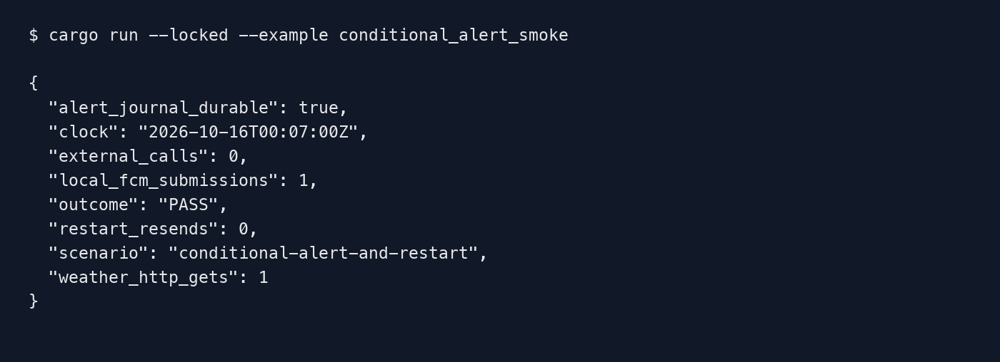
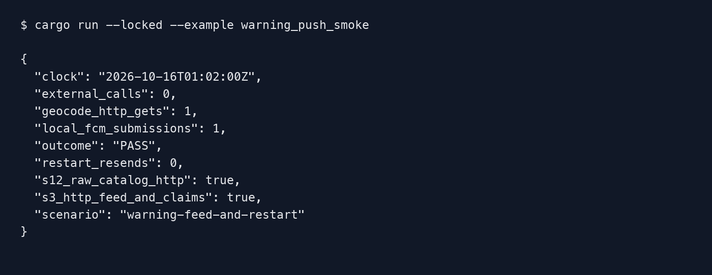

# Server2 push delivery

Editable operator guide for S18b-2 and S18b-3 (#2703), 2026-10-16. [PDF](server2-push-delivery.pdf)
and [sequence](../architecture/diagrams/server2-push-delivery.html).

## Capability and setup boundary

The `AlertWorker` library evaluates conditional registrations using server2's acknowledged
S3 state. It is not wired into the production entrypoint in this slice. S20 must create one
delivery owner, connect SERVICE_SERVER to server2's v000902 routes and provide the same
S18b-1 Firebase account configuration. Do not start legacy and server2 senders together.
There is no dry-run, mock or validation mode. Tests and the example inject synthetic peers.

## Selection and outcomes

The scheduler runs at UTC minutes 7, 17, 35 and 50. Registrations must be explicitly enabled
and inside their inclusive normal or overnight window. A weather or air push within the last
six hours suppresses that registration. Current precipitation and current air-grade
transitions can send; two successive wet shortest forecasts can trigger precipitation.
Air forecasts are computed but discarded, matching legacy. Overseas observations older than
30 minutes are skipped.

The worker claims the cycle in S3 before preparation and stores alert state before FCM. It
skips a registration changed by the user while weather was fetched. Each provider submission
is attempted once. Unknown outcomes and rejected submissions are not retried after restart.
An unregistered token disables all matching conditional registrations, without touching alarms.
Diagnostics omit tokens, names, coordinates and notification text.

| Outcome | Operator meaning |
| --- | --- |
| accepted | Local/provider API accepted the submission; this does not prove device delivery |
| rejected | Provider rejected it; do not resend this cycle |
| unknown | Outcome may have been delivered; do not resend |
| failed / state-not-committed | State could not be safely committed or the selected registration changed; nothing sent |
| not-needed | State was updated; no notification threshold transition |

## Local functional check

From `server2/`, run:

```sh
cargo run --locked --example conditional_alert_smoke
cargo test --locked --test delivery alerts::
```

The example creates one synthetic alert and local weather, OAuth and FCM HTTP peers. It
fetches weather, durably updates the alert, submits once and restores the S3 state into a new
service. It expects one weather GET, one local FCM submission and zero restart resends.
It reads no `.env`, real credentials or real device tokens and makes zero external calls.



## Deployment and failures

This PR does not deploy, attach a scheduler or send live notifications. Do not infer a live
FCM credential check or native device receipt from this local example. A refused cycle claim
or alert-state journal write prevents submission. A lost result object keeps the claim and
must never be replayed as a send. Ordinary conditional evaluations preserve registration
updatedAt; legacy's obsolete updateAt cleanup typo remains a no-op.

[Selected verification](../evidence/tasks/issue-2703-s18b2/verification.md) contains source
provenance, actual commands and limitations. Google documents the
[HTTP v1 send contract](https://firebase.google.com/docs/cloud-messaging/send/admin-sdk) and
[FCM error classes](https://firebase.google.com/docs/cloud-messaging/error-codes); observed
provider acceptance and real device delivery remain separate facts.

## Warning feed (S18b-3 library)

This slice provides the severe-warning feed and one-shot worker; it does not start
a live process. S20 installs `WarningCollector::with_push_feed` and a single
`WarningWorker` owner alongside the existing alarm/conditional workers. Its region
adapter must use server2's native `/geocode/v000903/coord/` route at cutover.

The first persisted feed and the first worker read are silent. Afterwards a fresh
issued/changed warning selects enabled alert registrations inside their time window
and current S12 warning zone. Multiple city registrations for one package/device
receive one attempt. Release, expiry, a concurrent user update or an unavailable
claim stops submission. Rejected, unknown or cancelled work is not automatically
retried; restarting cannot resume it. An independently issued later warning can
send again. An unregistered token disables alerts only.

S3 objects: `index/v2/push/warning-feed/head.json`, `events/<identity>.json`, and
`index/v2/push/delivery/warning/<campaign>/<endpoint>/<UTC-date>/<source-minute>`
claim/results. Claims and diagnostics contain hashes/record IDs and status classes,
not token, location, name or notification text. Keep these claims during recovery;
do not delete one to force delivery. Region and immutable-event memory caches can
be discarded; S3 remains authoritative. No warning local-disk capacity is required.

For local functional verification, the maintained example uses actual loopback S3,
geocode and OAuth/FCM HTTP peers plus synthetic registrations/service-account data:

```sh
cd server2
cargo run --locked --example warning_push_smoke
```

It never loads `.env` or calls a real provider/device. Successful execution must
report one local submission and zero restart resends. This does not prove actual
EC2-role permissions, deployed startup wiring or device delivery. New warning paths
already fit the checked-in IAM/bucket `index/v2/*` policy; no AWS mutation is needed.

After OAuth preparation, the final guard checks the latest S12 durable zone state
and catches up registration journals from S3, including other-process changes.
Disabled/changed registration, released warning, expired five-minute window or an
unavailable/timed-out guard results in no POST. The delivery claim remains terminal.



[Warning verification](../evidence/tasks/issue-2703-s18b3/verification.md) records the
actual legacy oracle and isolated failure checks. The image is a rendered capture
of actual stdout, with synthetic names and no device token or private credentials.
