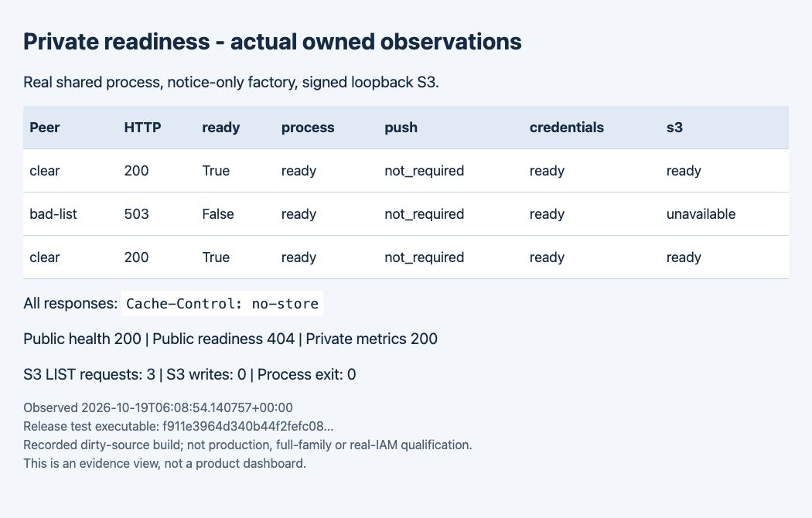

# Server2 private readiness

Use the existing private listener to check availability. This endpoint is not a production qualification or an authorization to switch traffic. Keep it off the public proxy.

## Inspect a running process

Use the configured private address (default `127.0.0.1:3001`), not the public listener:

```sh
curl --fail-with-body --max-time 4 -i http://127.0.0.1:3001/internal/ready
```

GET returns 200 when all required components are ready, otherwise 503. HEAD runs the same check without a response body. Responses use `Cache-Control: no-store`. POST returns 405 and performs no probe. The public listener keeps `/internal/ready` unmounted (404); `/health` remains basic liveness and private `/internal/metrics` stays available.

The JSON contains exactly `ready`, `process`, `push`, `credentials`, and `s3`. Process is `ready` or `stopping`; push is `ready`, `not_ready`, or `not_required`. Credentials and S3 are `ready`, `unavailable`, `not_checked`, or `not_required`. An explicitly code-injected partial factory can omit push or S3; `not_required` describes only that factory, never complete production configuration.

## Interpret an unavailable result

A restoring, failed, or closed push writer returns 503 before remote checks. A stop signal or lost stop sender also fails closed. For configured S3, a single three-second deadline includes credential-source readiness, shared S3 queue wait, one signed `raw/v2/` LIST (one key, 64 KiB maximum), and strict XML decoding through the existing CPU admission. Empty valid LIST is ready. Authentication failure, malformed/oversized data, network error, or deadline expiry is unavailable. No result is cached; a later successful probe recovers. Local state is checked again after the await so concurrent writer exit or stop cannot produce stale success.

Do not retry mutations or rewind claims when readiness fails. Inspect retained bounded diagnostics and the existing writer/stop state. This route does not write S3, call weather providers, refresh FCM credentials, send notifications, restart jobs, or create a background monitor. A credential-source success does not prove remote permissions. A successful LIST proves only that read on that prefix: GET/PUT, all prefixes, real-role missing-key behavior, provider/key quota, device delivery, host capacity, and complete recovery remain separate gates. Avoid high-frequency polling: every configured S3 probe performs one LIST.

## Owned verification

The captured workflow uses an optimized test executable that invokes the real shared process with an isolated notice-only factory, synthetic credentials, and an owned signed-S3 HTTP peer. Valid LIST returns 200, injected malformed LIST returns 503, then a valid LIST returns 200. Push is `not_required` in this specific fixture. This is not the full production family set, real AWS/IAM, or a live provider check.



The image is a browser capture of retained observations from the actual workflow. It is an evidence view, not a product dashboard. The selected receipt records source/binary hashes, three LIST requests, zero S3 writes, public 404, liveness 200, metrics 200, method 405, and retired listeners. See [verification and limits](../evidence/tasks/issue-2819-runtime-readiness/verification.md).

For a source checkout, the focused automated checks are:

```sh
cargo test --locked --test runtime_services readiness:: -- --test-threads=2
```

The additional optimized functional command is the selected release `runtime_services` executable with `--exact readiness::owned_readiness_wire_smoke --ignored --nocapture`. Coordinate its build through the shared Cargo lease and retain the executable outside the target directory before cleanup. No `.env`, provider secrets, real Firebase accounts, or device endpoints are used.
