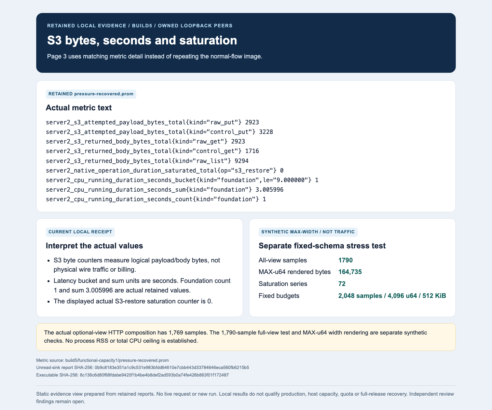

# Server2 runtime resources and private metrics

This operator guide covers the resource-aware construction at base `c1ae9082` plus the changes for #2819. It is repository preparation. It does not authorize deployment, provider traffic, notifications, shadowing or cutover. [Local evidence](../evidence/tasks/issue-2819-runtime-resource-metrics/verification.md) distinguishes the current normal, typed-capacity, unread-sink and main checks from historical runs and their immutable binary hashes.

## Read the private endpoint

Use the configured private listener to request `GET /internal/metrics`; keep it separate from the public origin. The public router does not mount these metrics. Do not expose the private listener through nginx or CloudFront. A successful response is complete Prometheus text with `Cache-Control: no-store`. If foundation-body reading or the combined exposition exceeds the fixed bound, the endpoint returns a bounded complete 500 response with no-store; it neither panics nor truncates a successful exposition. Scraping reads the attached in-process counters; it does not query S3, providers or the local cache filesystem. The HTTP middleware can count the scrape itself.

Fixed labels contain operation, component, outcome, CPU/S3 kind and status class. They contain no coordinate, station, provider URL, object key, registration, token or arbitrary error text. Process restart resets counters. A scrape is a relaxed snapshot across counters, not an atomic ledger or proof of a durable send. Use the typed delivery records and durable claims for delivery outcomes.

## Distinguish work from diagnostic output

`server2_native_operation_started_total` counts operation creation; `server2_native_operation_finished_total{op,outcome}` records terminal finish/drop once, before logging level, rate limiting or queue admission. Link/action records are not additional terminal finishes. Unknown, failed, cancelled and skipped remain distinct. Unmapped fixed component/stage combinations aggregate under `other`.

`server2_native_http_attempt_started_total` and `server2_native_http_attempt_finished_total` count actual polled HTTP attempts. `server2_native_http_headers_duration_*` stops when headers arrive, not when the response body finishes. Provider acquisition budgets retain their existing spend/reservation rules. HTTP attempts and operation counts have different denominators; do not sum them as a send count.

`server2_logging_filtered_total`, `server2_logging_rate_limited_total` and `server2_logging_queue_full_total` describe discarded diagnostic lines. Native operation/resource counters continue updating when those lines are suppressed. A quiet stderr is not evidence of no work.

## CPU admission and cancellation

Production construction creates `ProcessResources` before the service factory and shares its CPU admission and domestic collector counters. The selected native queue holds at most 16 waiting offers; the CPU limit comes from the existing configured process limit (two in the normal owned run). Read `server2_cpu_pool_limit`, `server2_cpu_pool_queue_limit`, `server2_cpu_queued{kind}`, `server2_cpu_active{kind}`, `server2_cpu_running{kind}` and `server2_cpu_pool_admitted_not_running` together. Queue wait and running-duration histograms measure separate intervals.

The migrated work is VC gzip/JSON, world and air restoration/parsing, and resource-aware S06 codecs/control documents. A stricter local gate precedes the process permit. Both permits live inside the actual blocking closure. Cancelling a waiter before admission releases its queue offer; cancelling after admission leaves the permits occupied until that closure exits. `queued_cancelled_total`, `started_cancelled_total`, `panic_total` and `stopped_total` have distinct meanings. A cancelled caller does not establish that CPU work has stopped.

Each CPU job reserves 10 ms before its effective owned-work deadline. With at most 10 ms remaining, no new CPU job starts. World cold work retains its eight-second owner and each caller its original three-second bound. An invocation-local observation covers queued, admitted-not-running and running CPU work; an interrupted completion remains observable after the inner future is dropped. The outer deadline can therefore preserve an actual CPU-capacity cause without relying only on the margin. Completed CPU followed by ordinary I/O timeout is not reclassified as capacity. Local refusal or CPU deadline does not count as provider failure or start another funded provider. After a funded attempt loses local parsing/publication capacity, a private two-second cooldown limits repeated demand. This is not the provider-down or invalid-body penalty. It does not refund a consumed attempt or authorize a retry. Panic and stopped work retain ordinary failure/transport handling and distinct counters; they do not enter this short local-capacity cooldown. A deadline is not also counted as started-caller cancellation. Gzipped 401/403 responses skip unused-body decoding. A 429 whose body is needed retains its existing body-based classification when decoding is available; actual CPU refusal remains local capacity, with the HTTP 429 already observed. No extra attempt, refund or inferred quota subtype is added.

This change does not claim that every parser or every process allocation shares this pool. Local KMA, warning and AirKorea work, and the separate D2/F2 changes, require explicit reconciliation in the whole candidate. Existing standalone constructors remain callable with their earlier ownership. No total-process CPU or RSS ceiling is established here.

## S3, cache and uncertain publication

The shared S3 gate retains FIFO admission and its existing 12 permits. It adds no priority, retry or larger concurrency limit. `server2_s3_pool_queued` and `server2_s3_pool_active` describe current admission; per-kind queue cancellation and active cancellation are separate. Queue-wait and service-duration histograms do not measure host/network latency independently.

`server2_s3_attempted_payload_bytes_total` counts logical submitted payload lengths. `server2_s3_returned_body_bytes_total` counts returned bodies known to this transport. Neither is physical wire traffic or AWS billing. The existing raw disk cache counters describe hits, misses, corruption, eviction, pending writes and observed/reserved bytes; they do not make the cache authoritative.

CPU loss before any possible write is not-attempted. Non-definite errors after possible writes, including inner timeouts and uncertain final readback, remain ambiguous. A definite rejected PUT status remains definite; a readback status after an unknown or acknowledged write does not erase the uncertainty. When all index writes were acknowledged, failure to materialize can yield Indexed only after a fresh validated pin succeeds; Indexed is not CompleteSet or body success. Invocation-scoped CPU provenance continues through publication, repair and load. Bounded fan-out stops refilling after the first error and drains already admitted work, preserving a real CPU refusal even when an ordinary error arrives first. Incomplete materialization remains incomplete while retaining its actual local cause. This prevents a cold air load from funding providers because local CPU work was refused, without relabelling unrelated concurrent transport failures. Neither metrics nor this flag authorize resending an uncertain body.

## Read latency and cardinality safely

The fixed latency buckets are 1, 5, 10, 50, 100, 500, 1000, 2500 and 9000 ms, then +Inf; exported units are seconds. Count is derived from the same loaded bucket cells. Integer-microsecond sums and counters saturate; each histogram family has a saturation counter. Treat a nonzero saturation value as a limit on further numerical interpretation. Do not infer a percentile from one request or mix buckets from different operations.

The implementation tests enumerate 1,719 core series, 1,640 new u64 cells (1,730 including the conservative existing-view reserve), and 1,790 samples with all private views attached. The normal owned composition exposed 1,769 samples because some optional views were absent. The max-u64-width test rendered 164,735 bytes, including comments. The fixed budgets remain 2,048 samples, 4,096 u64 cells and 512 KiB text. These are tested bounds for this fixed schema; adding a metric requires renewing the enumeration and render tests, not truncating output.

## Reproduce the owned checks

Build the `loopback_server` and `runtime_resource_metrics_smoke` release examples using the task's selected toolchain and a coordinated Cargo target. Check disk space and pending target consumers first. The checked runner starts only owned loopback peers and rejects a reused output directory. From the repository root, provide the retained executable paths:

```sh
python3 server2/tools/runtime_resource_metrics_smoke.py --binary PATH_TO_LOOPBACK_SERVER --out NEW_OUTPUT
python3 server2/tools/runtime_resource_metrics_smoke.py --capacity-binary PATH_TO_RESOURCE_EXAMPLE --out OTHER_NEW_OUTPUT
```

The normal flow checks native cold/warm public responses, shared CPU increments, private-only metrics and byte-identical restoration after process restart with providers down. The current build5 run reported 43.91 ms for its one local cold request; this is not EC2 cold p95 or a production performance qualification.

The capacity flow first runs a separate drained-sink case: one actual shared CPU permit is held, public 501 occurs at 3001.26 ms with an actual typed world capacity/return_error action before release, and VC/air attempts stay zero. It then runs the original unread-pipe pressure case, with public 501 at 2997.14 ms, zero VC/air attempts, private metrics progress, and public 200 with one VC and one air attempt after the holder actually exits. Its 2,048 synthetic successful `other` operations are measured before native traffic; three later native `other` successes are separate. The pressure run observed queue_full626 and rate_limited3104. It drains the pipe and joins the drainer before stopping all owned children. Do not reproduce the pressure by blocking a production log sink.

[Editable PDF source](../evidence/tasks/issue-2819-runtime-resource-metrics/manual.json) uses three same-directory retained captures: [normal flow](../evidence/tasks/issue-2819-runtime-resource-metrics/normal.png), [typed capacity and synthetic pressure](../evidence/tasks/issue-2819-runtime-resource-metrics/capacity.png), and the metric detail below. These inputs remain available in a clean checkout.



The image must present the selected current retained reports and metric lines; it is an evidence view, not a live product dashboard. The current raw HTTP receipts contain 1,769 samples and 130,413–130,616 bytes across eleven captured expositions; each scrape asserted HTTP200 and no-store inline. Raw header blocks and public response bodies were not separately persisted; warm and provider-down restore byte equality were actual runner assertions. The separate maximum-width/all-view tests are not additional normal-traffic measurements. Production thresholds, host capacity, IAM/SigV4/TLS, quota headroom, seven-day shadow and both eligible full recovery bundles remain separate gates. Keep #2704, #2705 and #2819 open until their full criteria are met.

The [shared factory and resource flow](../architecture/diagrams/server2-runtime-services.html)
([editable JSON](../architecture/diagrams/server2-runtime-services.json)) must be refreshed by root to pin the committed corrected
runtime source before publishing the matching diagram. It is a repository flow, not a deployed topology.
