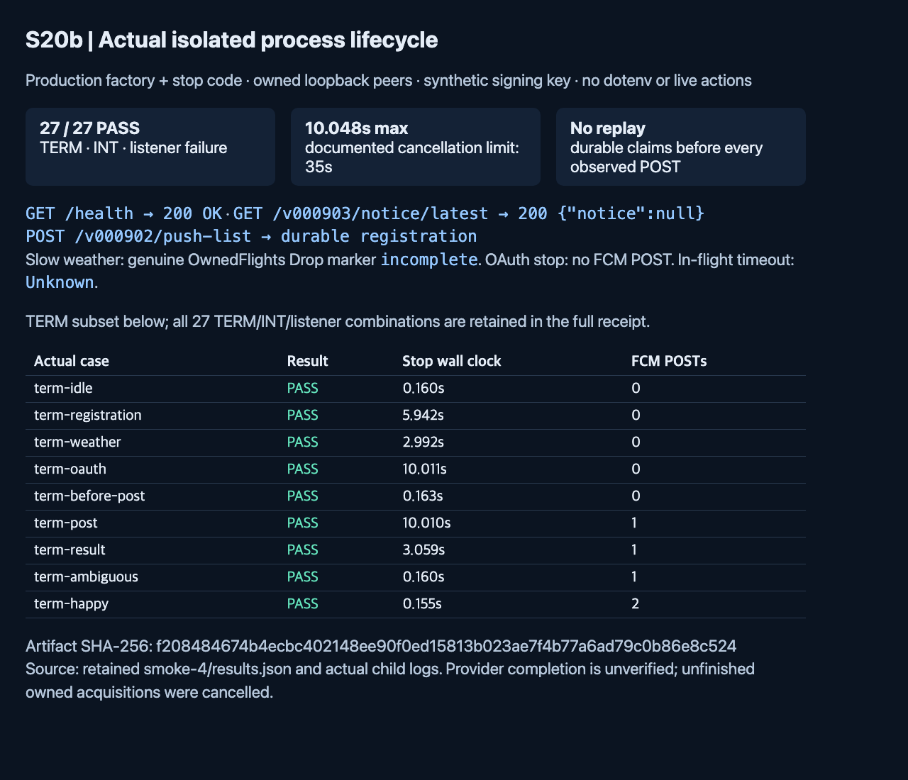

# Server2 runtime services

S20b connects ordinary push selection to supervised alarm, conditional-alert and warning workers through the shared S20a production factory. This is repository behavior, not a production activation or cutover claim. Normal startup with `push` selected starts delivery loops after both listeners bind. Do not run that startup with real credentials/endpoints during development verification.

## Select and start

`SERVER2_NATIVE_FAMILIES` uses the existing `push` and `notice` entries. Native-only selection needs no legacy URL. Push builds shared native KMA, DSF and geocoder dependencies even when their public weather routes are unselected; existing provider configuration requirements remain. One bounded S3 transport/credential cache serves registrations, delivery claims/results, warning store/feed and notices. Construction performs no weather precollection, OAuth or FCM request. Notice GET/HEAD never instantiates Translator or a paid client.

Workers use typed NativeFetch with logical origin `http://server2.internal`, existing v000902 weather paths, units and full weather Accept-Language. It makes no self HTTP request; SERVICE_SERVER/API_SERVER and legacy forwarding do not select the worker destination. The existing 12-second native HTTP connection lifetime and 9-second registration wait remain.

Both public and private listeners must bind before delivery starts. Alarm and conditional jobs run at the next observed UTC minute; conditional selection remains :07/:17/:35/:50. A delayed wake evaluates the current minute, and a queued tick that became stale is rejected before claim work. Missed minutes are never replayed. Warning polls are serialized every five seconds; the first successful poll establishes a silent baseline. Warning data acquisition stays request driven.

FCM accounts remain lazy per product: `SERVER2_FIREBASE_TODAYWEATHER` and the existing TodayAir setting point to account files. Missing/invalid files fail that product's send, not startup or another product. Retired TodayAir is no new mandatory account. Future deployment readiness must verify the real required files separately before activation. Development uses only synthetic public test-vector keys.

## Registration, notices and delivery safety

Existing registration routes remain `POST /v000705/push`, `PUT`/`DELETE /v000902/push`, and `POST /v000902/push-list`. Preserve existing payloads/language headers. Acknowledgement follows durable journal publication; cold/unavailable storage keeps the route's existing storage-error response. Quiescing rejects new mutations with those responses. Queued writes may settle during drain; an unacknowledged or cancelled write is incomplete and must be reconciled from authoritative S3.

`GET /v000903/notice/latest` returns `{"notice":null}` for no publication. Explicit lang precedes Accept-Language. GET/HEAD retain public max-age=300 and Vary: Accept-Language; corrupt/unreadable cold storage returns 503/no-store. POST is not publication. The separate notice CLI owns publishing and translation.

Delivery claims are durable before FCM POST and remain immutable across overlapping workers/restart. Alarm admission rechecks current subscription/minute after OAuth; timestamp-only refresh does not change the subscription. Conditional admission rechecks the committed alert selection and current time/window without changing legacy normalization/filter semantics. Warning admission retains writer catch-up plus current zones/time checks. Stop is checked again after asynchronous guards, immediately before POST. Stop-before-POST is NotSent; a POST whose response is lost/times out is Unknown. Neither failed nor ambiguous work is automatically resent. An edit after POST admission remains protected from stale cleanup; the send may already have occurred.

## Stop and inspect

SIGTERM, SIGINT and listener failure share one stop path. Signals are registered before service/listener startup. Stop closes scheduling and new FCM POST admission, quiesces registrations and closes HTTP listeners. The supervisor owns all spawned minute/poll jobs; the writer has an explicit close/join/abort handle. Listener failure still reports an error after cleanup.

When a push writer or delivery supervisor exists, the total shutdown cancellation envelope is **35 seconds**: one shared 34-second deadline for concurrent HTTP/jobs/writer drain, then at most one second of runtime teardown. With neither push writer nor delivery, HTTP retains its **5-second shared drain plus at most 1 second teardown**. A signal that exhausts that HTTP-only deadline logs `signal drain deadline; forced stop`, before the foundation 9-second socket age. Listener failures use the same selected deadline and retain an error result. It is not a claim that every admitted operation completes. Native weather waits are 3 seconds each; OAuth and FCM are 10 seconds each; ledger operations are 4 seconds, writer S3 operations 2 seconds, and a queued writer guard can wait up to 9 seconds. Multiple fetches/guards, cleanup or large batches can exceed the envelope; outstanding jobs/writes are cancelled and classified incomplete, with claims retained and no replay. Cancellation joins never wait past that same deadline.

Native owned acquisitions can outlive their 3-second waiter, up to their existing owner bounds. Their full completion is unverified during shutdown; unfinished asynchronous work is cancelled at runtime teardown, and any partial publication must be recovered from S3. `delivery_joined`/`writer_joined`/`http_joined` describe owned handles, not completed provider acquisition or successful delivery. A deadline message means incomplete work. No signal result establishes production readiness.

## Reproduce isolated verification

Run the focused Rust runtime/delivery tests through the configured toolchain and shared build lease. `process::child` is ignored by ordinary test runs; the smoke tool alone supplies its stdin dependencies. Retain the built runtime_services test executable and its SHA-256 inside the lease, then run:

```sh
python3 server2/tools/runtime_services_smoke.py \
  --binary /absolute/path/to/retained-runtime-services-test \
  --out reports/sdlc/issue-2705-s20b/smoke
```

The tool clears the child environment, loads no dotenv file, and injects owned loopback S3/native/OAuth/FCM peers and synthetic keys through the same production factory/stop code. It exercises public registration/notice/health, scheduled alarm/conditional jobs, silent warning polling, actual TERM/INT/listener failures, queued registration, slow weather/OAuth, final pre-POST guard, in-flight POST/result write, and durable restart/no-replay. Its native test handler uses actual OwnedFlights; an incomplete task's Drop marker proves runtime cancellation. Production endpoint bounds and shared test-peer configuration are unchanged.

See the [S20b verification record](../evidence/tasks/issue-2705-s20b/verification.md), [editable diagram](../architecture/diagrams/server2-runtime-services.json), [interactive diagram](../architecture/diagrams/server2-runtime-services.html) and [PDF manual](server2-runtime-services.pdf). The capture below shows actual isolated usage/results, not device delivery.



CI and eligible independent review are separate exact-head gates. Real providers, AWS/Mongo, device sends, paid translation, deployment/cutover, EC2/quota measurement, seven-day shadow and full S20/#2742 acceptance remain excluded.
