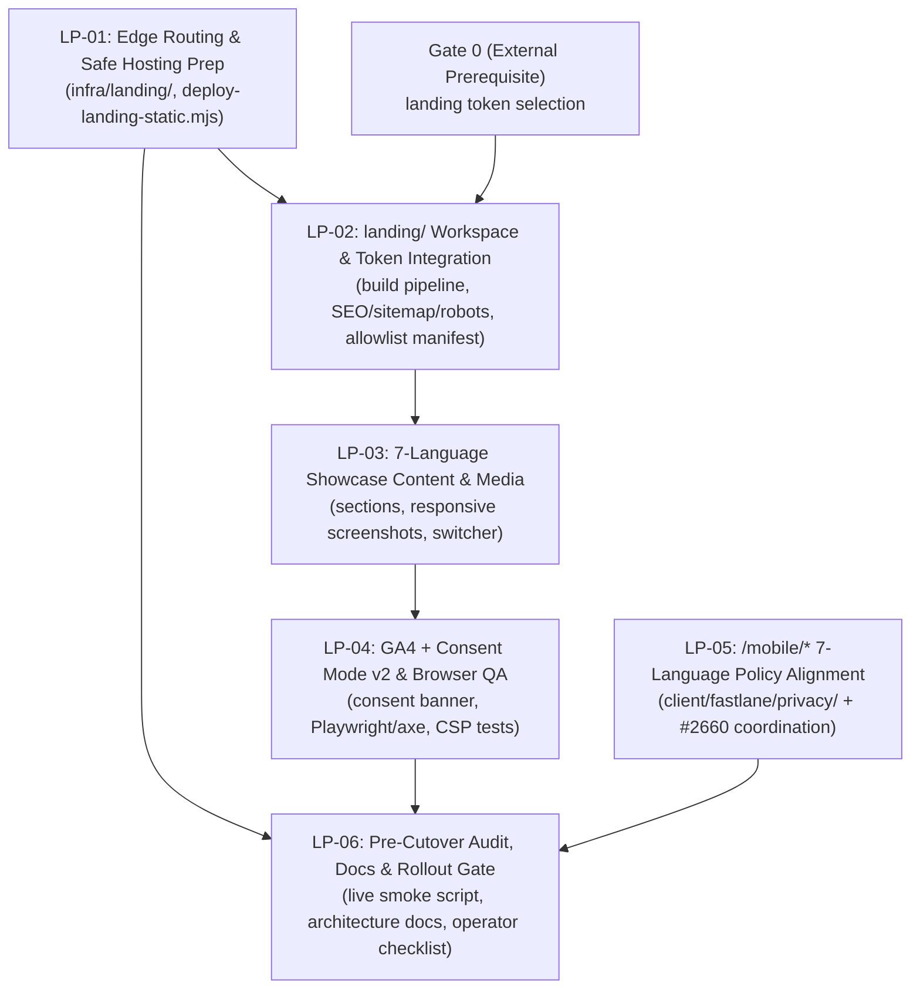

# `todayweather.ai` Brand Landing Page — Implementation Plan

Inputs: [Landing intent](../intent/landing.md) · [Landing specification](../specs/landing.md) · [Store release & landing hosting](../docs/operations/cordova-store-release.md#privacysupport-hosting-on-the-landing-site) · [Web static runbook](../infra/web/static/README.md).

Endpoint: local intent, specification and plan. The slices below describe subsequent implementation and release work, subject to separate authorization.

---

## 1. Prerequisite Gate & Critical Path

> **Mandatory Prerequisite (`Gate 0`) — Shared tokens for the landing**
> Map the first landing layout to the existing shared roles. Use the existing chart roles when selecting captures or rendering a chart example. The hourly chart has today (`chart.today`), yesterday (`chart.yesterday.line`, `chart.yesterday.dot` and `chart.yesterday.on`) and current time (`chart.now`). The daily range uses `chart.range.cool`, `chart.range.warm` and `chart.range.edge`. Try `type.display` for the headline, `type.body` for copy and `accent.default`, `accent.on` and `focus.ring` for the primary CTA. In the first layout, check headline wrapping at 200% zoom and long translations before proposing a new type role. Gate 0 closes when the chosen public CSS roles resolve in both themes and the existing token and contrast checks pass.
> **First layout review, 2026-11-21.** The [Korean draft and capture sources](../landing/README.md) use the existing public CSS roles and the original chart imagery. The draft passed the 12 design checks. The reviewed layouts fit 360, 390, 768 and 1440 CSS pixels, including a separate long German heading and CTA sample at 200% CSS zoom on 390 and 1440 px viewports. Keep the headline scaling local for this layout. Revisit a shared role if translated pages or another product surface need the same treatment. The seven-language release checks remain in LP-03.
> - **Parallelizable before Gate 0 finishes**: `LP-01` (edge routing function, golden test cases, infra runbook, safe uploader skeleton) and `LP-05` (`/mobile/*` 7-language policy HTML expansion, coordinated with `#2660`) do not depend on visual tokens and can be prepared independently.
> - **Blocked until Gate 0 finishes**: `LP-02` (workspace scaffold + token wiring), `LP-03` (7-language UI, responsive layout, real screenshots, SEO), `LP-04` (GA4 + Consent Mode v2 + Playwright/axe suite), `LP-06` (final integration, live smoke prep, rollout gate).

**UI and integration sequence**: `Gate 0 (landing token selection)` → `LP-02` → `LP-03` → `LP-04` → `LP-06`. LP-01 also gates LP-02. The LP-05 policy release must reach LP-06 before the seven-language cutover.
**Ready frontier (before Gate 0 completes)**: `LP-01` and `LP-05` (independent write scopes, 2-way parallel).
**First visual review (LP-03).** Start with a Korean mobile and desktop layout. In the hourly crop, keep both line labels and the date boundary visible. In the daily crop, show the current marker between the daily extrema. Show a home-screen widget in use. Use the [reviewed capture list](../landing/README.md#product-captures) for both charts and updated widget designs. Keep the WebApp accessible through a direct link on mobile and desktop. Check legibility at the intended display size before preparing all seven translations.

**Linked separate follow-ups (non-blocking)**:
- `FU-1` (`#2613`): Update `#2613`, `docs/webapp/specification.md`, and `web/src/locale.ts` to remove "region ignored" wording and preserve country context for unsupported languages (`zh-TW`, `it-CH`, `ko-US`); separately decide native mobile `S07` unit-setting simplification.
- `FU-2` (`#2660` / `#2613`): Legal sign-off on `.de`/`.fr`/`.pt`/`.es` policy translations + GA4 web-analytics disclosure clauses, and native iOS/Android policy URL expansion from 3 to 7 languages. Native link expansion stays separate. Reviewed translations gate policy publication, and published analytics disclosures gate GA4 activation.

---

## 2. Ordered Vertical Slices & PR Boundaries

Each slice is scoped as a coherent, independently verifiable PR targeting `master` (no overlapping write scopes among parallel PRs):

| Slice | Title & Outcome | Dependencies | Owned Write Scope | Covered AC | Planned Verification |
| --- | --- | --- | --- | --- | --- |
| **LP-01** | **Edge routing, safe uploader & infra runbook**: Implement `infra/landing/route-request.js`, unit tests, isolated CloudFront policy spec with protected-path compatibility, `infra/landing/README.md` (backup/reuse/rollback), and `scripts/deploy-landing-static.mjs` (dry-run, allowlist, forbidden-path block, distribution preflight). | None (**Ready frontier**) | `infra/landing/**`, `scripts/deploy-landing-static.mjs`, `scripts/test/landing-edge-and-deploy.test.mjs` | AC1, AC3, AC8 | Node unit tests for `route-request.js` (Accept-Language, cookie precedence, query preservation, `/app-ads.txt` & `/mobile/*` pass-through) and uploader first-cutover and routine preflight tests, plus allowlist, partial retry and rollback tests |
| **LP-02** | **`landing/` workspace, refreshed token pipeline & SEO/build harness**: Add `landing/` to root npm workspaces consuming the public CSS export from `packages/design-tokens/`, static build generating `/index.html` fallback + 7 locale shells + `/404.html` + `/robots.txt` + `/sitemap.xml` + `landing-release.json`, and local static preview server mirroring CloudFront routing + CSP. | `Gate 0`, `LP-01` | `package.json` and root lockfile (workspace/scripts), `landing/package.json`, `landing/vite.config.*` (or build script), `landing/src/**` (shell/i18n/SEO), `scripts/landing-static-preview.mjs` | AC2, AC7 | `npm run build -w @todayweather/landing`, build output allowlist assertion, `hreflang`/canonical/`sitemap.xml`/`robots.txt` validation, preview HTTP smoke |
| **LP-03** | **7-language showcase content, responsive screenshots & a shared opening link**: Author natural everyday copy for `ko, en, ja, de, fr, pt, es`, optimize native chart and current widget captures for both themes, use a single hero action to the link host’s `/open` and a direct WebApp link in the platform section, implement all landing sections (`hero`, `features`, `platforms`, `sources`, `footer`, language switcher cookie), and verify multi-viewport layout + contrast. | `LP-02` | `landing/src/i18n/**`, `landing/src/sections/**`, `landing/src/styles/**`, `landing/public/og/**`, `landing/assets/**` | AC2, AC4 | Playwright layout check across 7 languages × mobile (`360×800`, `390×844`) / tablet (`768×1024`) / desktop (`1280×800`, `1440×900`) verifying `scrollWidth <= clientWidth`, 200% zoom readability, dark/light themes, and zero weather API calls |
| **LP-04** | **GA4 + Consent Mode v2, preference UI & full browser/a11y suite**: Implement Basic Consent Mode v2, EEA/UK/CH and unknown-region opt-in, global footer preferences and CTA events. Qualify the edge region signal and default-measurement country allowlist in spec §6 before enabling GA4. | `LP-03` | `landing/src/analytics/**`, `landing/src/consent/**`, `landing/tests/**` | AC6 | Playwright tests for zero Google requests before grant in EEA/UK/CH and unknown regions, spoofed or cached region signals, eligible-region defaults, accept/reject/revoke, sanitized payloads, CSP and axe AA accessibility |
| **LP-05** | **`/mobile/*` 7-language policy HTML expansion**: Add `.de.html`, `.fr.html`, `.pt.html`, `.es.html` for `privacy`, `terms`, and `support` under `client/fastlane/privacy/`, update cross-language navigation on all 21 files, prepare the web-analytics disclosure with #2660, and verify the policy documents under their existing protected-path behavior. | None (**Ready frontier**, parallel with `LP-01`) | `client/fastlane/privacy/**`, `docs/operations/cordova-store-release.md` (policy upload list update) | AC5 | Automated HTML and link checks plus a browser check for style and header compatibility across all 21 policy files + preservation check confirming existing `ko`/`en`/`ja` URLs unchanged |
| **LP-06** | **Live smoke tooling, architecture docs & production rollout gate**: Add read-only `scripts/landing-live-smoke.mjs`, update architecture/operations docs (including three-domain map and `#2613` locale-contract cross-reference), prepare operator pre-cutover inventory checklist (`$LANDING_BUCKET`, `$LANDING_DISTRIBUTION`, `LANDING_GA_ID`, App Store storefront status), and complete pre-release verification. | `LP-01`, `LP-04`, `LP-05` | `scripts/landing-live-smoke.mjs`, `docs/architecture/README.md`, `docs/architecture/web-client.md`, `docs/architecture/diagrams/landing-*`, `docs/operations/landing-deploy.md` (extends the LP-01 runbook) | AC1, AC3, AC5, AC8, AC9 | Local preview run of `landing-live-smoke.mjs`, `python3 scripts/check-artifact-policy.py --staged`, full workspace test/build green, an isolated cutover/rollback rehearsal and a documented operator checklist |

> **Integration ownership**: The implementation coordinator integrates authorized PRs serially onto `master` after CI and independent review. LP-01 defines the edge and upload contracts, LP-02 and LP-03 supply and render the content, and LP-06 verifies the integrated release candidate.

---

## 3. User Scenarios (Mandatory Planning Traceability)

| ID | User & Goal | Prerequisites | Ordered Actions | Expected Result | Failure Path / Regression Check | AC |
| --- | --- | --- | --- | --- | --- | --- |
| **S1** | **Korean mobile visitor** opening `https://todayweather.ai` from search or store link to install or open TodayWeather | Browser `Accept-Language: ko-KR,ko;q=0.9`, no `tw_locale` cookie | 1. Request `GET /?utm_source=search` → 2. Follow `302` to `/ko/?utm_source=search` → 3. Inspect hero → 4. Select Open TodayWeather | Immediate `302` to `/ko/` preserving `utm_source`; Korean copy, Pretendard typography, one hero CTA to `https://link.todayweather.ai/open`, zero weather API calls | If `Accept-Language` is missing or malformed, cleanly redirects to `/en/` without 5xx; no cached redirect leakage across users | AC2, AC3, AC4 |
| **S2** | **Unsupported-language visitor** (e.g., Traditional Chinese `zh-TW` or Italian-Swiss `it-CH`) visiting `https://todayweather.ai` | Browser `Accept-Language: zh-TW,zh;q=0.9` or `it-CH,it;q=0.9` | 1. Request `GET /` → 2. Follow `302` → 3. Inspect rendered page and consent state | Redirects `302` to `/en/`; English landing renders cleanly. A visitor classified as CH by the qualified signal, or with unknown classification, sees the English consent banner and sends no Google analytics requests before granting consent | The product locale examples preserve TW or CH. On the landing page the browser tag alone cannot grant analytics eligibility | AC3, AC6, AC9 |
| **S3** | **Manual language switcher user** overriding browser language | Browser `Accept-Language: en-US`, currently on `/en/` | 1. Open language switcher → 2. Select `日本語` → 3. Revisit `https://todayweather.ai/` | Navigates to `/ja/`, sets functional cookie `tw_locale=ja`; subsequent visit to `/` redirects `302` to `/ja/` instead of `/en/` | Invalid/tampered `tw_locale` cookie values (e.g., `../etc`) are ignored and fall back safely to `Accept-Language` → `/en/` | AC3, AC4 |
| **S4** | **Search crawler or shared-link recipient** opening a direct locale URL | Crawler/user with `Accept-Language: ko-KR` requesting `GET /de/` | 1. Request `GET /de/` directly → 2. Inspect status, `<html lang="de">`, `canonical`, `hreflang`, and layout at `360px` | Returns HTTP `200` directly (no redirect to `/ko/`); German copy fits without horizontal overflow; `canonical` and all 7 `hreflang` + `x-default` tags are valid | Trailing-slash omission (`GET /de`) returns `301` to `/de/` preserving query string; unknown path (`/unknown-foo`) returns `404`/`403`, never `200` | AC3, AC4, AC7 |
| **S5** | **EU/UK/CH visitor** managing analytics privacy on `https://todayweather.ai/fr/` | Qualified FR visitor classification or unknown region, no `tw_consent` cookie | 1. Load `/fr/` → 2. Reject analytics in banner → 3. Verify network panel → 4. Open footer "Analytics & Cookie Settings" and grant consent → 5. Click WebApp CTA | Before choice and after Reject, zero GA4 requests fire and `analytics_storage` stays `denied`. After opting in via footer modal, `cta_click` fires with approved parameters. Revoking returns the page to a tag-free state | When `LANDING_GA_ID` is absent (dev/CI), UI works cleanly with zero JS/CSP errors; ad signals remain `denied` in all states | AC6 |
| **S6** | **User opening legal or support link** from landing footer or mobile app | User on `/es/` (or existing mobile app opening `/mobile/privacy.html`) | 1. Click Privacy / Terms / Support in `/es/` footer → 2. Verify `/mobile/privacy.es.html` loads → 3. Verify legacy `/mobile/privacy.html` still loads `200` | Matching Spanish policy page loads `200` with working styles with working 7-language nav; existing `ko`/`en`/`ja` URLs remain untouched and `200` | No edge redirect intercepts `/mobile/*`; missing/unreviewed final legal text clearly retains `#2660` draft banner until legal approval | AC1, AC5 |
| **S7** | **AdMob crawler & Store review bot** verifying `app-ads.txt` and Developer Website | Live `https://todayweather.ai` after landing deployment | 1. `GET /app-ads.txt` → 2. `GET /robots.txt` → 3. `GET /sitemap.xml` | `/app-ads.txt` returns `200 text/plain; charset=utf-8` with byte-identical pre-deploy hash; `/robots.txt` and `/sitemap.xml` return `200` | Uploader aborts before any AWS call if local build attempts to emit `app-ads.txt`, `mobile/*`, or `.well-known/*` | AC1, AC7, AC8 |
| **S8** | **Operator deploying or rolling back** `todayweather.ai` | Verified `$LANDING_BUCKET`, `$LANDING_DISTRIBUTION`, `$LANDING_BACKUP_DIR` | 1. Run dry-run uploader → 2. Record mutable object versions and live CloudFront settings → 3. Upload and verify route targets → 4. Activate edge routing and run smoke → 5. Rehearse rollback in isolation | Dry-run reports exact allowlisted upload plan without AWS writes; `--execute` refuses `-dirty` builds or misconfigured distribution; rollback restores the previous landing release or placeholder and preserves the approved protected-path baseline | Distribution alias mismatch, non-empty `OriginPath`, custom error-to-200 mapping, or stale function on a routine update fails preflight before any S3 write | AC1, AC8 |
| **S9** | **International iOS visitor** following a shared locale link | Browser language differs from visited page. Global App Store availability is unverified | 1. Open a shared `/ko/` or `/en/` URL → 2. Select Open TodayWeather and inspect the browser fallback | The requested translation stays visible. Both languages use the same opening link. The browser fallback offers store and WebApp choices | Unverified universal App Store link stays out of the release. Verify storefront evidence before switching the link | AC3, AC4 |

---

## 4. Operational Deployment & Rollback Boundary (Human-Authorized Only)

No production mutation occurs during implementation PRs. Actual rollout happens only after AK approves a release window and provides operator inputs:

1. **Read-only inventory and backup.** Confirm the owner account, bucket, versioning, distribution and aliases. Capture CloudFront configuration, current ETag and restorable function settings. Record the version IDs, metadata and hashes of changed mutable landing keys and the paths that lacked prior objects. Verify storefronts and protected-path headers and hashes.
2. **Publish reviewed policy documents.** Use the separate [policy upload procedure](../docs/operations/cordova-store-release.md#privacysupport-hosting-on-the-landing-site). Verify all seven languages and record the authorized post-update hashes. Verify that GA4 disclosures are public before enabling measurement. Keep GA4 disabled if the region signal or default-measurement policy is unqualified.
3. **Stage and verify landing files.** Run the uploader dry-run, then the authorized execute path. Upload hashed dependencies before HTML and verify exact object keys and hashes. Check all seven explicit index URLs. First-cutover preflight accepts the recorded existing configuration. Routine deployment verifies the matching live edge associations.
4. **Activate routing and verify.** After route targets are in place, attach the reviewed edge function and isolated response headers policy. Preserve the protected routes' behavior. Wait for CloudFront deployment and invalidate changed mutable public URLs and rewritten index paths. Run `scripts/landing-live-smoke.mjs --base https://todayweather.ai --expect-commit <sha>` and compare protected-path responses with the approved post-policy hashes and pre-cutover headers.
5. **Rollback if smoke fails.** Restore the known-good CloudFront associations and configuration with the current ETag and restore the previous version of each overwritten landing-owned mutable key. For first cutover, restore the previous root and use the rehearsed cleanup decision for newly introduced keys. Preserve old hashed assets and the independent policy release. Wait for edge propagation, invalidate affected paths, then verify restored behavior and protected assets.

---

## 5. Blast Radius, Risks & Rejected Alternatives

| Risk / Blast Radius | Mitigation |
| --- | --- |
| Accidental deletion/overwrite of `/app-ads.txt` or `/mobile/*` breaks AdMob verification (`#2871`) and store/in-app legal links (`#2660`) | Allowlist-only uploader, hard-coded forbidden-key guard, zero S3 delete calls, S3 versioning backup, post-deploy live smoke hash check |
| Stricter CSP breaks policy styling or GA4 | Preserve protected response behavior and verify styles in a browser. Test the landing CSP with both analytics states |
| Non-KR App Store URL returning `404` before global launch (`#2613`) | Check live storefront status before release; use a verified and clearly labeled regional storefront link until global availability is verified |
| False country or cached visitor classifications start analytics before consent | Confirm trusted coarse region source and response isolation. Require opt-in for unknown classifications and keep GA4 disabled until production gates pass |
| Changes to shared token roles can affect the production WebApp | Hard `Gate 0` dependency before `LP-02`/`LP-03` |

### Rejected Alternatives

- **24-path `/{lang}-{country}/` landing URLs**: Rejected (DL-L2) because duplicating copy across 6 English and 6 Spanish country paths increases SEO duplicate-content and translation maintenance costs with little benefit when store links and `app.todayweather.ai` already adapt per country.
- **Client-side JS redirect at `/` without CloudFront Function**: Rejected (DL-L3) due to initial flash/FOUC, weaker crawler handling, and slower first paint.
- **Live weather API widget on landing hero**: Rejected (DL-L4) to keep `todayweather.ai` instant, SEO-clean, and fully insulated from backend/CORS outages.
- **Merging landing into `web/` (PWA)**: Rejected (DL-L6) because the PWA service worker precache, SPA navigation rewrite, and `app.todayweather.ai` deployment guards would conflict with `todayweather.ai`'s co-located `/app-ads.txt` and `/mobile/*` assets.
